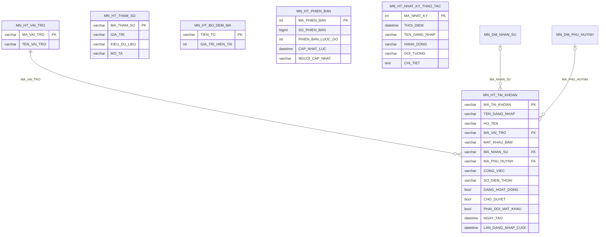
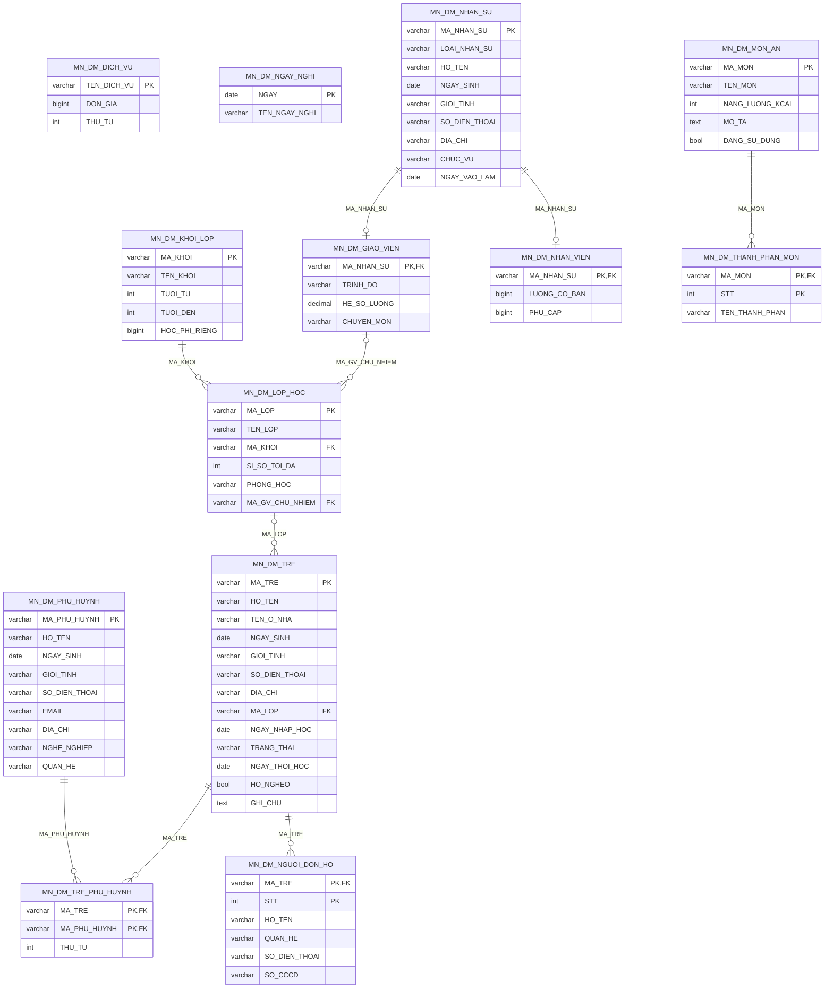
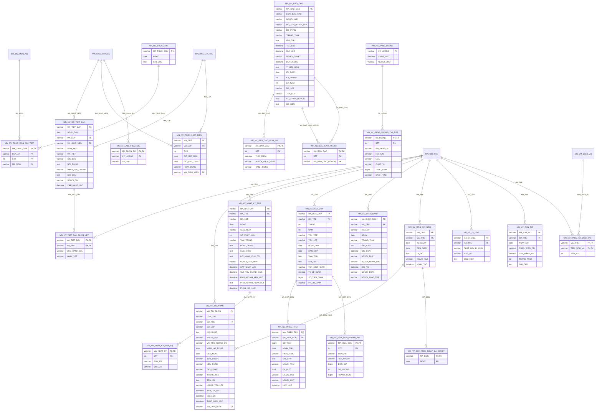

# Thiết kế cơ sở dữ liệu - Hệ thống quản lý Nhà trẻ - Mẫu giáo

> Phần 4 - 6 (sơ đồ ERD, khóa ngoại, từ điển dữ liệu) được **sinh tự động** từ định nghĩa lược đồ trong
> `kindergarten/storage/schema.py` bằng lệnh `python Database/sinh_tai_lieu_csdl.py`, nên luôn khớp với
> CSDL mà chương trình tạo ra. Phần 1 - 3 viết tay trong `Database/_thiet_ke_mo_dau.md`.
>
> Hệ quản trị CSDL: **SQLite** - toàn bộ CSDL là một file `data/ql_mam_non.db`, không cần cài máy chủ.
> Xem / sửa bảng bằng **DB Browser for SQLite** (mở thẳng file `.db`).

Thiết kế làm theo các bước trong *Hướng dẫn xây dựng HTTTQL* (SAMI - HUST), phần **III. Thiết kế → Thiết kế CSDL**:
liệt kê thực thể cụ thể / trừu tượng → xác định quan hệ 1-1, 1-n, n-n (mô tả thuộc tính của liên kết n-n) →
chuyển sang mô hình quan hệ, chỉ rõ khóa chính, khóa ngoại → xác định thực thể phụ → kiểm tra đủ thuộc tính,
đúng kiểu dữ liệu.

## 1. Quy ước

| Quy ước | Áp dụng |
|---|---|
| Tên CSDL | `ql_mam_non` - file SQLite `data/ql_mam_non.db` (UTF-8, tiếng Việt đầy đủ dấu); bật `PRAGMA foreign_keys = ON` để khóa ngoại có hiệu lực |
| Tên bảng | VIẾT HOA, `SUB_SYSTEM + PURPOSE_TYPE + NAME`: `MN` = phân hệ Mầm non; `HT` = quản trị hệ thống (F1.1), `DM` = thông tin danh mục (F1.2), `NV` = nghiệp vụ (F1.3, F1.4). Ví dụ `MN_DM_TRE`, `MN_NV_HOA_DON` |
| Tên cột | VIẾT HOA, tiếng Việt không dấu: `MA_...` = mã (khóa), `TEN_...`, `NGAY_...`, `SO_...`; mỗi cột có chú thích (COMMENT) |
| Khóa chính | Mã nghiệp vụ dạng chuỗi do chương trình cấp (`C001`, `HD012`...) - dễ đọc trên hóa đơn, phiếu thu; bảng chi tiết dùng khóa ghép (mã cha + `STT`) |
| Khóa ngoại | Đặt tên `FK_<bảng>_<n>`, luôn `ON UPDATE CASCADE`; `ON DELETE` chọn theo nghiệp vụ (xem mục 5) |
| Kiểu dữ liệu | Tiền: `BIGINT` (đồng, không có phần lẻ); tỷ lệ: `DECIMAL(8,6)`; chiều cao / cân nặng: `DECIMAL(6,2)`; đúng/sai: `TINYINT(1)` (0/1); ngày: `DATE` (`yyyy-mm-dd`); thời điểm: `DATETIME` (`yyyy-mm-dd hh:mm:ss`); giờ học: `TIME` (`hh:mm`) |

> SQLite lưu dữ liệu theo "kiểu gần đúng" (type affinity): `DATE`, `DATETIME`, `TIME` được lưu dạng văn bản ISO như
> trên nên sắp xếp, so sánh, dùng hàm `date()`, `strftime()` đúng; chương trình tự đổi qua lại thành ngày giờ.

## 2. Thực thể

**Thực thể cụ thể** (người, vật có thật): Trẻ (`MN_DM_TRE`), Phụ huynh (`MN_DM_PHU_HUYNH`), Nhân sự
(`MN_DM_NHAN_SU`) chuyên biệt hóa thành Giáo viên (`MN_DM_GIAO_VIEN`) và Nhân viên (`MN_DM_NHAN_VIEN`),
Lớp học (`MN_DM_LOP_HOC`), Món ăn (`MN_DM_MON_AN`), Người đón hộ (`MN_DM_NGUOI_DON_HO`), Tài khoản (`MN_HT_TAI_KHOAN`).

**Thực thể trừu tượng** (sự kiện, giao dịch, chứng từ): Điểm danh - đón trả (`MN_NV_DIEM_DANH`), Đơn xin nghỉ
(`MN_NV_DON_XIN_NGHI`), Cân đo (`MN_NV_CAN_DO`), Dị ứng (`MN_NV_DI_UNG`), Thời khóa biểu (`MN_NV_THOI_KHOA_BIEU`),
Hóa đơn (`MN_NV_HOA_DON`) - Khoản phí (`MN_NV_HOA_DON_KHOAN_PHI`) - Phiếu thu (`MN_NV_PHIEU_THU`), Thực đơn
(`MN_NV_THUC_DON`), Nhật ký ăn ngủ (`MN_NV_NHAT_KY_TRE`), Tin nhắn trao đổi (`MN_NV_TIN_NHAN`), Báo cáo
(`MN_NV_BAO_CAO`), Bảng lương đã chốt (`MN_NV_BANG_LUONG`), Giờ làm thêm (`MN_NV_LAM_THEM_GIO`).

**Thực thể phụ** (danh mục nhỏ, tham số): Vai trò (`MN_HT_VAI_TRO`), Khối lớp (`MN_DM_KHOI_LOP`), Dịch vụ tự chọn
(`MN_DM_DICH_VU`), Ngày nghỉ lễ (`MN_DM_NGAY_NGHI`), Tham số hệ thống (`MN_HT_THAM_SO`), Bộ đếm mã
(`MN_HT_BO_DEM_MA`), Phiên bản dữ liệu (`MN_HT_PHIEN_BAN`), Nhật ký thao tác (`MN_HT_NHAT_KY_THAO_TAC`).

## 3. Quan hệ giữa các thực thể

**Quan hệ 1 - 1**
- Nhân sự - Giáo viên, Nhân sự - Nhân viên: chuyên biệt hóa (bảng con dùng chính `MA_NHAN_SU` làm khóa chính).
- Giáo viên - Lớp chủ nhiệm (1 - 0..1): `MN_DM_LOP_HOC.MA_GV_CHU_NHIEM` có ràng buộc `UNIQUE`.
- Tài khoản - Nhân sự, Tài khoản - Phụ huynh (0..1 - 1): tài khoản đăng nhập của giáo viên / kế toán / nhân viên / phụ huynh.

**Quan hệ 1 - n**
- Khối lớp - Lớp học; Lớp học - Trẻ; Lớp học - Tiết học (thời khóa biểu); Vai trò - Tài khoản.
- Trẻ - Điểm danh, Cân đo, Dị ứng, Đơn xin nghỉ, Nhật ký, Tin nhắn, Hóa đơn, Người đón hộ.
- Hóa đơn - Khoản phí, Hóa đơn - Phiếu thu; Món ăn - Thành phần; Nhật ký - Mức ăn từng bữa; Đơn xin nghỉ - Tin nhắn.
- Báo cáo - Lịch sử xử lý; Bảng lương - Chi tiết lương; Nhân viên - Giờ làm thêm.

**Quan hệ n - n** (tách bảng trung gian, kèm thuộc tính của liên kết)

| Quan hệ | Bảng trung gian | Thuộc tính của liên kết |
|---|---|---|
| Trẻ - Phụ huynh | `MN_DM_TRE_PHU_HUYNH` | `THU_TU` (thứ tự liên hệ) |
| Trẻ - Dịch vụ tự chọn | `MN_NV_DANG_KY_DICH_VU` | `THU_TU` |
| Thực đơn - Món ăn | `MN_NV_THUC_DON_CHI_TIET` | `BUA_AN` (sáng / trưa / xế), `STT` |
| Báo cáo toàn trường - Báo cáo bộ phận | `MN_NV_BAO_CAO_NGUON` | `STT` |

**Một số quyết định thiết kế**
- *Dữ liệu lịch sử giữ nguyên giá trị tại thời điểm phát sinh*: hóa đơn lưu `TEN_TRE`, `TEN_LOP`; điểm danh, nhật ký,
  tin nhắn lưu `MA_LOP` của ngày đó (không ràng buộc khóa ngoại - trẻ chuyển lớp hay lớp giải thể thì lịch sử vẫn đúng);
  bảng lương đã chốt và số liệu báo cáo đã gửi (`MN_NV_BAO_CAO.SO_LIEU`) là văn bản cố định, không tính lại.
- *Cột tính toán*: `MN_NV_HOA_DON_KHOAN_PHI.THANH_TIEN = DON_GIA × IFNULL(SO_LUONG, 1)` do SQLite tự tính
  (`GENERATED ALWAYS AS ... STORED`) - truy vấn tổng tiền không cần lặp lại công thức.
- *Ràng buộc kiểm tra (CHECK)*: thứ trong tuần 0 - 6, tháng 1 - 12, ngày kết thúc đơn nghỉ ≥ ngày bắt đầu, loại nhân sự.
- *Xóa dây chuyền có chủ đích*: xóa hồ sơ trẻ (nhập nhầm) thì điểm danh, nhật ký, cân đo... của trẻ đó cũng bị xóa;
  món ăn đang có trong thực đơn, dịch vụ đang có trẻ đăng ký, báo cáo đã được dùng làm nguồn thì **không cho xóa**.
- *Phiên bản dữ liệu*: `MN_HT_PHIEN_BAN` (số phiên bản tăng sau mỗi lần lưu, ai lưu, lúc nào) và `MN_HT_BO_DEM_MA`
  (bộ đếm mã) giúp hai cửa sổ chương trình mở cùng một file không ghi đè dữ liệu của nhau. Cách hai thành viên
  trao đổi dữ liệu: `HUONG_DAN_LAM_VIEC_NHOM.md`.

| Nhóm chức năng (sơ đồ phân cấp chức năng) | Bảng chính |
|---|---|
| F1.1 Quản trị hệ thống | `MN_HT_TAI_KHOAN`, `MN_HT_VAI_TRO`, `MN_HT_THAM_SO`, `MN_HT_NHAT_KY_THAO_TAC` |
| F1.2 Quản lý thông tin danh mục | `MN_DM_TRE`, `MN_DM_PHU_HUYNH`, `MN_DM_NHAN_SU`, `MN_DM_LOP_HOC`, `MN_DM_MON_AN`, `MN_DM_DICH_VU`, `MN_DM_KHOI_LOP`, `MN_DM_NGAY_NGHI` |
| F1.3 Vận hành hằng ngày | `MN_NV_DIEM_DANH`, `MN_NV_NHAT_KY_TRE`, `MN_NV_TIN_NHAN`, `MN_NV_DON_XIN_NGHI`, `MN_NV_THUC_DON`, `MN_NV_CAN_DO`, `MN_NV_THOI_KHOA_BIEU` |
| F1.4 Tài chính - nhân sự | `MN_NV_HOA_DON`, `MN_NV_PHIEU_THU`, `MN_NV_DANG_KY_DICH_VU`, `MN_NV_BANG_LUONG`, `MN_NV_LAM_THEM_GIO` |
| F1.5 Báo cáo thống kê | `MN_NV_BAO_CAO`, `MN_NV_BAO_CAO_NGUON`, `MN_NV_BAO_CAO_LICH_SU` (+ truy vấn mẫu `03_truy_van_mau.sql`) |

## 4. Sơ đồ thực thể liên kết (ERD)

Mở bằng VS Code (cài *Markdown Preview Mermaid Support*), GitHub, hoặc dán vào <https://mermaid.live>. Ký hiệu: `||--o{` = 1 - n, `|o--o{` = 0..1 - n (khóa ngoại được để trống), `||--o|` = 1 - 0..1.

### F1.1 - Quản trị hệ thống

### F1.2 - Thông tin danh mục

### F1.3/F1.4 - Nghiệp vụ

### Toàn bộ quan hệ giữa các bảng (chỉ tên bảng)

```mermaid
erDiagram
    MN_HT_VAI_TRO ||--o{ MN_HT_TAI_KHOAN : "MA_VAI_TRO"
    MN_DM_NHAN_SU |o--o{ MN_HT_TAI_KHOAN : "MA_NHAN_SU"
    MN_DM_PHU_HUYNH |o--o{ MN_HT_TAI_KHOAN : "MA_PHU_HUYNH"
    MN_DM_NHAN_SU ||--o| MN_DM_GIAO_VIEN : "MA_NHAN_SU"
    MN_DM_NHAN_SU ||--o| MN_DM_NHAN_VIEN : "MA_NHAN_SU"
    MN_DM_KHOI_LOP ||--o{ MN_DM_LOP_HOC : "MA_KHOI"
    MN_DM_GIAO_VIEN |o--o{ MN_DM_LOP_HOC : "MA_GV_CHU_NHIEM"
    MN_DM_LOP_HOC |o--o{ MN_DM_TRE : "MA_LOP"
    MN_DM_TRE ||--o{ MN_DM_TRE_PHU_HUYNH : "MA_TRE"
    MN_DM_PHU_HUYNH ||--o{ MN_DM_TRE_PHU_HUYNH : "MA_PHU_HUYNH"
    MN_DM_TRE ||--o{ MN_DM_NGUOI_DON_HO : "MA_TRE"
    MN_DM_MON_AN ||--o{ MN_DM_THANH_PHAN_MON : "MA_MON"
    MN_DM_NHAN_SU ||--o{ MN_NV_LAM_THEM_GIO : "MA_NHAN_SU"
    MN_DM_TRE ||--o{ MN_NV_DANG_KY_DICH_VU : "MA_TRE"
    MN_DM_DICH_VU ||--o{ MN_NV_DANG_KY_DICH_VU : "TEN_DICH_VU"
    MN_DM_LOP_HOC ||--o{ MN_NV_THOI_KHOA_BIEU : "MA_LOP"
    MN_DM_NHAN_SU |o--o{ MN_NV_THOI_KHOA_BIEU : "MA_GIAO_VIEN"
    MN_DM_TRE ||--o{ MN_NV_CAN_DO : "MA_TRE"
    MN_DM_TRE ||--o{ MN_NV_DI_UNG : "MA_TRE"
    MN_DM_TRE ||--o{ MN_NV_DON_XIN_NGHI : "MA_TRE"
    MN_NV_DON_XIN_NGHI ||--o{ MN_NV_DON_NGHI_NGAY_DA_DUYET : "MA_DON"
    MN_DM_TRE ||--o{ MN_NV_DIEM_DANH : "MA_TRE"
    MN_DM_TRE ||--o{ MN_NV_HOA_DON : "MA_TRE"
    MN_NV_HOA_DON ||--o{ MN_NV_HOA_DON_KHOAN_PHI : "MA_HOA_DON"
    MN_NV_HOA_DON ||--o{ MN_NV_PHIEU_THU : "MA_HOA_DON"
    MN_NV_THUC_DON ||--o{ MN_NV_THUC_DON_CHI_TIET : "MA_THUC_DON"
    MN_DM_MON_AN ||--o{ MN_NV_THUC_DON_CHI_TIET : "MA_MON"
    MN_DM_TRE ||--o{ MN_NV_NHAT_KY_TRE : "MA_TRE"
    MN_NV_NHAT_KY_TRE ||--o{ MN_NV_NHAT_KY_BUA_AN : "MA_NHAT_KY"
    MN_DM_TRE |o--o{ MN_NV_TIN_NHAN : "MA_TRE"
    MN_NV_DON_XIN_NGHI |o--o{ MN_NV_TIN_NHAN : "MA_DON_NGHI"
    MN_DM_LOP_HOC ||--o{ MN_NV_SO_TIET_DAY : "MA_LOP"
    MN_DM_NHAN_SU ||--o{ MN_NV_SO_TIET_DAY : "MA_GIAO_VIEN"
    MN_NV_SO_TIET_DAY ||--o{ MN_NV_TIET_DAY_NHAN_XET : "MA_TIET_DAY"
    MN_DM_TRE ||--o{ MN_NV_TIET_DAY_NHAN_XET : "MA_TRE"
    MN_NV_BAO_CAO ||--o{ MN_NV_BAO_CAO_NGUON : "MA_BAO_CAO"
    MN_NV_BAO_CAO ||--o{ MN_NV_BAO_CAO_NGUON : "MA_BAO_CAO_NGUON"
    MN_NV_BAO_CAO ||--o{ MN_NV_BAO_CAO_LICH_SU : "MA_BAO_CAO"
    MN_NV_BANG_LUONG ||--o{ MN_NV_BANG_LUONG_CHI_TIET : "KY_LUONG"
```

## 5. Mô hình quan hệ - danh sách khóa ngoại

| Bảng cha (1) | Bảng con (n) | Khóa ngoại | Kiểu quan hệ | Khi xóa dòng cha |
|---|---|---|---|---|
| `MN_HT_VAI_TRO` | `MN_HT_TAI_KHOAN` | `MA_VAI_TRO` | 1 - n | không cho xóa |
| `MN_DM_NHAN_SU` | `MN_HT_TAI_KHOAN` | `MA_NHAN_SU` | 0..1 - n | để trống liên kết |
| `MN_DM_PHU_HUYNH` | `MN_HT_TAI_KHOAN` | `MA_PHU_HUYNH` | 0..1 - n | để trống liên kết |
| `MN_DM_NHAN_SU` | `MN_DM_GIAO_VIEN` | `MA_NHAN_SU` | 1 - 0..1 (chuyên biệt hóa) | xóa theo |
| `MN_DM_NHAN_SU` | `MN_DM_NHAN_VIEN` | `MA_NHAN_SU` | 1 - 0..1 (chuyên biệt hóa) | xóa theo |
| `MN_DM_KHOI_LOP` | `MN_DM_LOP_HOC` | `MA_KHOI` | 1 - n | không cho xóa |
| `MN_DM_GIAO_VIEN` | `MN_DM_LOP_HOC` | `MA_GV_CHU_NHIEM` | 0..1 - n | để trống liên kết |
| `MN_DM_LOP_HOC` | `MN_DM_TRE` | `MA_LOP` | 0..1 - n | để trống liên kết |
| `MN_DM_TRE` | `MN_DM_TRE_PHU_HUYNH` | `MA_TRE` | 1 - n | xóa theo |
| `MN_DM_PHU_HUYNH` | `MN_DM_TRE_PHU_HUYNH` | `MA_PHU_HUYNH` | 1 - n | xóa theo |
| `MN_DM_TRE` | `MN_DM_NGUOI_DON_HO` | `MA_TRE` | 1 - n | xóa theo |
| `MN_DM_MON_AN` | `MN_DM_THANH_PHAN_MON` | `MA_MON` | 1 - n | xóa theo |
| `MN_DM_NHAN_SU` | `MN_NV_LAM_THEM_GIO` | `MA_NHAN_SU` | 1 - n | xóa theo |
| `MN_DM_TRE` | `MN_NV_DANG_KY_DICH_VU` | `MA_TRE` | 1 - n | xóa theo |
| `MN_DM_DICH_VU` | `MN_NV_DANG_KY_DICH_VU` | `TEN_DICH_VU` | 1 - n | không cho xóa |
| `MN_DM_LOP_HOC` | `MN_NV_THOI_KHOA_BIEU` | `MA_LOP` | 1 - n | xóa theo |
| `MN_DM_NHAN_SU` | `MN_NV_THOI_KHOA_BIEU` | `MA_GIAO_VIEN` | 0..1 - n | để trống liên kết |
| `MN_DM_TRE` | `MN_NV_CAN_DO` | `MA_TRE` | 1 - n | xóa theo |
| `MN_DM_TRE` | `MN_NV_DI_UNG` | `MA_TRE` | 1 - n | xóa theo |
| `MN_DM_TRE` | `MN_NV_DON_XIN_NGHI` | `MA_TRE` | 1 - n | xóa theo |
| `MN_NV_DON_XIN_NGHI` | `MN_NV_DON_NGHI_NGAY_DA_DUYET` | `MA_DON` | 1 - n | xóa theo |
| `MN_DM_TRE` | `MN_NV_DIEM_DANH` | `MA_TRE` | 1 - n | xóa theo |
| `MN_DM_TRE` | `MN_NV_HOA_DON` | `MA_TRE` | 1 - n | xóa theo |
| `MN_NV_HOA_DON` | `MN_NV_HOA_DON_KHOAN_PHI` | `MA_HOA_DON` | 1 - n | xóa theo |
| `MN_NV_HOA_DON` | `MN_NV_PHIEU_THU` | `MA_HOA_DON` | 1 - n | xóa theo |
| `MN_NV_THUC_DON` | `MN_NV_THUC_DON_CHI_TIET` | `MA_THUC_DON` | 1 - n | xóa theo |
| `MN_DM_MON_AN` | `MN_NV_THUC_DON_CHI_TIET` | `MA_MON` | 1 - n | không cho xóa |
| `MN_DM_TRE` | `MN_NV_NHAT_KY_TRE` | `MA_TRE` | 1 - n | xóa theo |
| `MN_NV_NHAT_KY_TRE` | `MN_NV_NHAT_KY_BUA_AN` | `MA_NHAT_KY` | 1 - n | xóa theo |
| `MN_DM_TRE` | `MN_NV_TIN_NHAN` | `MA_TRE` | 0..1 - n | xóa theo |
| `MN_NV_DON_XIN_NGHI` | `MN_NV_TIN_NHAN` | `MA_DON_NGHI` | 0..1 - n | để trống liên kết |
| `MN_DM_LOP_HOC` | `MN_NV_SO_TIET_DAY` | `MA_LOP` | 1 - n | xóa theo |
| `MN_DM_NHAN_SU` | `MN_NV_SO_TIET_DAY` | `MA_GIAO_VIEN` | 1 - n | xóa theo |
| `MN_NV_SO_TIET_DAY` | `MN_NV_TIET_DAY_NHAN_XET` | `MA_TIET_DAY` | 1 - n | xóa theo |
| `MN_DM_TRE` | `MN_NV_TIET_DAY_NHAN_XET` | `MA_TRE` | 1 - n | xóa theo |
| `MN_NV_BAO_CAO` | `MN_NV_BAO_CAO_NGUON` | `MA_BAO_CAO` | 1 - n | xóa theo |
| `MN_NV_BAO_CAO` | `MN_NV_BAO_CAO_NGUON` | `MA_BAO_CAO_NGUON` | 1 - n | không cho xóa |
| `MN_NV_BAO_CAO` | `MN_NV_BAO_CAO_LICH_SU` | `MA_BAO_CAO` | 1 - n | xóa theo |
| `MN_NV_BANG_LUONG` | `MN_NV_BANG_LUONG_CHI_TIET` | `KY_LUONG` | 1 - n | xóa theo |

## 6. Từ điển dữ liệu

Tổng cộng **42 bảng**: 6 bảng hệ thống, 13 bảng danh mục, 23 bảng nghiệp vụ. Bảng chi tiết (xóa / ghi lại cùng thực thể cha): `MN_DM_GIAO_VIEN`, `MN_DM_NGUOI_DON_HO`, `MN_DM_NHAN_VIEN`, `MN_DM_THANH_PHAN_MON`, `MN_DM_TRE_PHU_HUYNH`, `MN_NV_BANG_LUONG_CHI_TIET`, `MN_NV_BAO_CAO_LICH_SU`, `MN_NV_BAO_CAO_NGUON`, `MN_NV_DANG_KY_DICH_VU`, `MN_NV_DON_NGHI_NGAY_DA_DUYET`, `MN_NV_HOA_DON_KHOAN_PHI`, `MN_NV_LAM_THEM_GIO`, `MN_NV_NHAT_KY_BUA_AN`, `MN_NV_PHIEU_THU`, `MN_NV_THUC_DON_CHI_TIET`, `MN_NV_TIET_DAY_NHAN_XET`.

### F1.1 - Quản trị hệ thống

#### `MN_HT_VAI_TRO` - Vai trò người dùng - mỗi vai trò là một phân hệ

| Cột | Kiểu | Khóa | Bắt buộc | Ý nghĩa |
|---|---|---|---|---|
| `MA_VAI_TRO` | VARCHAR(20) | PK | x | Mã vai trò (admin, teacher, accountant, staff, parent) |
| `TEN_VAI_TRO` | VARCHAR(100) |  | x | Tên vai trò |

#### `MN_HT_TAI_KHOAN` - Tài khoản đăng nhập

| Cột | Kiểu | Khóa | Bắt buộc | Ý nghĩa |
|---|---|---|---|---|
| `MA_TAI_KHOAN` | VARCHAR(20) | PK | x | Mã tài khoản (TKxxx) |
| `TEN_DANG_NHAP` | VARCHAR(50) | UNIQUE | x | Tên đăng nhập |
| `HO_TEN` | VARCHAR(150) |  | x | Họ tên hiển thị |
| `MA_VAI_TRO` | VARCHAR(20) | FK → `MN_HT_VAI_TRO` | x | Vai trò |
| `MAT_KHAU_BAM` | VARCHAR(255) |  | x | Mật khẩu đã băm (PBKDF2-SHA256) |
| `MA_NHAN_SU` | VARCHAR(20) | FK → `MN_DM_NHAN_SU` |  | Nhân sự gắn với tài khoản (GV, KT, NV) |
| `MA_PHU_HUYNH` | VARCHAR(20) | FK → `MN_DM_PHU_HUYNH` |  | Phụ huynh gắn với tài khoản |
| `CONG_VIEC` | VARCHAR(50) |  |  | Công việc của nhân viên (bếp, bảo vệ, y tế) |
| `SO_DIEN_THOAI` | VARCHAR(20) |  |  | Số điện thoại |
| `DANG_HOAT_DONG` | TINYINT(1) |  | x | 1 = đang hoạt động |
| `CHO_DUYET` | TINYINT(1) |  | x | 1 = tự đăng ký, chờ Ban giám hiệu duyệt |
| `PHAI_DOI_MAT_KHAU` | TINYINT(1) |  | x | 1 = bắt buộc đổi mật khẩu khi đăng nhập |
| `NGAY_TAO` | DATETIME |  |  | Tạo lúc |
| `LAN_DANG_NHAP_CUOI` | DATETIME |  |  | Đăng nhập gần nhất |

#### `MN_HT_THAM_SO` - Tham số hệ thống (học phí chung, tiền ăn, tỷ lệ miễn giảm, lương cơ sở...)

| Cột | Kiểu | Khóa | Bắt buộc | Ý nghĩa |
|---|---|---|---|---|
| `MA_THAM_SO` | VARCHAR(50) | PK | x | Mã tham số |
| `GIA_TRI` | VARCHAR(255) |  | x | Giá trị |
| `KIEU_DU_LIEU` | VARCHAR(10) |  | x | int / float / bool |
| `MO_TA` | VARCHAR(255) |  |  | Ý nghĩa |

#### `MN_HT_BO_DEM_MA` - Bộ đếm sinh mã tự động (C021, HD039...) - dùng chung cho cả nhóm

| Cột | Kiểu | Khóa | Bắt buộc | Ý nghĩa |
|---|---|---|---|---|
| `TIEN_TO` | VARCHAR(10) | PK | x | Tiền tố mã (C, PH, HD...) |
| `GIA_TRI_HIEN_TAI` | INT |  | x | Số thứ tự đã cấp gần nhất |

#### `MN_HT_PHIEN_BAN` - Phiên bản dữ liệu - phát hiện thay đổi của người dùng khác

| Cột | Kiểu | Khóa | Bắt buộc | Ý nghĩa |
|---|---|---|---|---|
| `MA_PHIEN_BAN` | TINYINT | PK | x | Luôn = 1 (bảng một dòng) |
| `SO_PHIEN_BAN` | BIGINT |  | x | Tăng 1 sau mỗi lần lưu |
| `PHIEN_BAN_LUOC_DO` | INT |  | x | Phiên bản thiết kế CSDL |
| `CAP_NHAT_LUC` | DATETIME |  |  | Lần lưu gần nhất |
| `NGUOI_CAP_NHAT` | VARCHAR(150) |  |  | Người / máy lưu gần nhất |

#### `MN_HT_NHAT_KY_THAO_TAC` - Nhật ký thao tác (ai làm gì, lúc nào)

| Cột | Kiểu | Khóa | Bắt buộc | Ý nghĩa |
|---|---|---|---|---|
| `MA_NHAT_KY` | INTEGER (tự tăng) | PK | x | Mã nhật ký (tự tăng) |
| `THOI_DIEM` | DATETIME |  | x | Thời điểm |
| `TEN_DANG_NHAP` | VARCHAR(50) |  |  | Người thực hiện |
| `HANH_DONG` | VARCHAR(190) |  | x | Hành động |
| `DOI_TUONG` | VARCHAR(500) |  |  | Đối tượng tác động |
| `CHI_TIET` | TEXT |  |  | Chi tiết (JSON) |

### F1.2 - Thông tin danh mục

#### `MN_DM_KHOI_LOP` - Khối lớp theo độ tuổi (Nhà trẻ, Mầm, Chồi, Lá)

| Cột | Kiểu | Khóa | Bắt buộc | Ý nghĩa |
|---|---|---|---|---|
| `MA_KHOI` | VARCHAR(30) | PK | x | Mã khối |
| `TEN_KHOI` | VARCHAR(50) |  | x | Tên khối |
| `TUOI_TU` | TINYINT |  |  | Tuổi từ |
| `TUOI_DEN` | TINYINT |  |  | Tuổi đến |
| `HOC_PHI_RIENG` | BIGINT |  |  | Học phí riêng của khối (NULL = dùng học phí chung) |

#### `MN_DM_DICH_VU` - Dịch vụ tự chọn (năng khiếu, tiếng Anh...) và bảng giá

| Cột | Kiểu | Khóa | Bắt buộc | Ý nghĩa |
|---|---|---|---|---|
| `TEN_DICH_VU` | VARCHAR(100) | PK | x | Tên dịch vụ (khóa tự nhiên) |
| `DON_GIA` | BIGINT |  | x | Giá mỗi tháng (đồng) |
| `THU_TU` | INT |  |  | Thứ tự hiển thị |

#### `MN_DM_NGAY_NGHI` - Lịch năm học - ngày nghỉ lễ

| Cột | Kiểu | Khóa | Bắt buộc | Ý nghĩa |
|---|---|---|---|---|
| `NGAY` | DATE | PK | x | Ngày nghỉ |
| `TEN_NGAY_NGHI` | VARCHAR(150) |  | x | Tên ngày nghỉ |

#### `MN_DM_NHAN_SU` - Nhân sự của trường (thực thể cha của giáo viên / nhân viên)

| Cột | Kiểu | Khóa | Bắt buộc | Ý nghĩa |
|---|---|---|---|---|
| `MA_NHAN_SU` | VARCHAR(20) | PK | x | Mã nhân sự (Txxx giáo viên, NVxxx nhân viên) |
| `LOAI_NHAN_SU` | VARCHAR(10) |  | x | GIAO_VIEN / NHAN_VIEN |
| `HO_TEN` | VARCHAR(150) |  | x | Họ tên |
| `NGAY_SINH` | DATE |  |  | Ngày sinh |
| `GIOI_TINH` | VARCHAR(10) |  |  | Giới tính |
| `SO_DIEN_THOAI` | VARCHAR(20) |  |  | Số điện thoại |
| `DIA_CHI` | VARCHAR(255) |  |  | Địa chỉ |
| `CHUC_VU` | VARCHAR(50) |  |  | Chức vụ |
| `NGAY_VAO_LAM` | DATE |  |  | Ngày vào làm |

Ràng buộc kiểm tra: `LOAI_NHAN_SU IN ('GIAO_VIEN', 'NHAN_VIEN')`

#### `MN_DM_GIAO_VIEN` - Thông tin riêng của giáo viên (quan hệ 1-1 với MN_DM_NHAN_SU)

| Cột | Kiểu | Khóa | Bắt buộc | Ý nghĩa |
|---|---|---|---|---|
| `MA_NHAN_SU` | VARCHAR(20) | PK FK → `MN_DM_NHAN_SU` | x | Mã giáo viên |
| `TRINH_DO` | VARCHAR(50) |  |  | Trình độ |
| `HE_SO_LUONG` | DECIMAL(5,2) |  |  | Hệ số lương |
| `CHUYEN_MON` | VARCHAR(100) |  |  | Chuyên môn (Âm nhạc, Tiếng Anh...) |

#### `MN_DM_NHAN_VIEN` - Thông tin riêng của nhân viên (quan hệ 1-1 với MN_DM_NHAN_SU)

| Cột | Kiểu | Khóa | Bắt buộc | Ý nghĩa |
|---|---|---|---|---|
| `MA_NHAN_SU` | VARCHAR(20) | PK FK → `MN_DM_NHAN_SU` | x | Mã nhân viên |
| `LUONG_CO_BAN` | BIGINT |  |  | Lương cơ bản (đồng) |
| `PHU_CAP` | BIGINT |  |  | Phụ cấp (đồng) |

#### `MN_DM_LOP_HOC` - Lớp học

| Cột | Kiểu | Khóa | Bắt buộc | Ý nghĩa |
|---|---|---|---|---|
| `MA_LOP` | VARCHAR(20) | PK | x | Mã lớp (Lxxx) |
| `TEN_LOP` | VARCHAR(100) |  | x | Tên lớp |
| `MA_KHOI` | VARCHAR(30) | FK → `MN_DM_KHOI_LOP` | x | Khối lớp |
| `SI_SO_TOI_DA` | INT |  |  | Sĩ số tối đa |
| `PHONG_HOC` | VARCHAR(30) |  |  | Phòng học |
| `MA_GV_CHU_NHIEM` | VARCHAR(20) | FK → `MN_DM_GIAO_VIEN` UNIQUE |  | Giáo viên chủ nhiệm (mỗi GV chủ nhiệm tối đa 1 lớp) |

#### `MN_DM_PHU_HUYNH` - Phụ huynh

| Cột | Kiểu | Khóa | Bắt buộc | Ý nghĩa |
|---|---|---|---|---|
| `MA_PHU_HUYNH` | VARCHAR(20) | PK | x | Mã phụ huynh (PHxxx) |
| `HO_TEN` | VARCHAR(150) |  | x | Họ tên |
| `NGAY_SINH` | DATE |  |  | Ngày sinh |
| `GIOI_TINH` | VARCHAR(10) |  |  | Giới tính |
| `SO_DIEN_THOAI` | VARCHAR(20) |  |  | Số điện thoại |
| `EMAIL` | VARCHAR(150) |  |  | Email |
| `DIA_CHI` | VARCHAR(255) |  |  | Địa chỉ |
| `NGHE_NGHIEP` | VARCHAR(100) |  |  | Nghề nghiệp |
| `QUAN_HE` | VARCHAR(30) |  |  | Quan hệ với trẻ (Bố, Mẹ, Ông, Bà...) |

#### `MN_DM_TRE` - Hồ sơ trẻ

| Cột | Kiểu | Khóa | Bắt buộc | Ý nghĩa |
|---|---|---|---|---|
| `MA_TRE` | VARCHAR(20) | PK | x | Mã trẻ (Cxxx) |
| `HO_TEN` | VARCHAR(150) |  | x | Họ tên |
| `TEN_O_NHA` | VARCHAR(50) |  |  | Tên ở nhà |
| `NGAY_SINH` | DATE |  | x | Ngày sinh |
| `GIOI_TINH` | VARCHAR(10) |  |  | Giới tính |
| `SO_DIEN_THOAI` | VARCHAR(20) |  |  | Số điện thoại liên hệ |
| `DIA_CHI` | VARCHAR(255) |  |  | Địa chỉ |
| `MA_LOP` | VARCHAR(20) | FK → `MN_DM_LOP_HOC` |  | Lớp đang học (NULL = chưa xếp lớp) |
| `NGAY_NHAP_HOC` | DATE |  |  | Ngày nhập học |
| `TRANG_THAI` | VARCHAR(30) |  |  | Đang học / Đã nghỉ / Đã ra trường |
| `NGAY_THOI_HOC` | DATE |  |  | Ngày thôi học |
| `HO_NGHEO` | TINYINT(1) |  | x | 1 = hộ nghèo (được miễn giảm) |
| `GHI_CHU` | TEXT |  |  | Ghi chú |

#### `MN_DM_TRE_PHU_HUYNH` - Quan hệ n-n giữa trẻ và phụ huynh

| Cột | Kiểu | Khóa | Bắt buộc | Ý nghĩa |
|---|---|---|---|---|
| `MA_TRE` | VARCHAR(20) | PK FK → `MN_DM_TRE` | x | Trẻ |
| `MA_PHU_HUYNH` | VARCHAR(20) | PK FK → `MN_DM_PHU_HUYNH` | x | Phụ huynh |
| `THU_TU` | INT |  | x | Thứ tự phụ huynh của trẻ |

#### `MN_DM_NGUOI_DON_HO` - Người được phép đón trẻ thay bố mẹ

| Cột | Kiểu | Khóa | Bắt buộc | Ý nghĩa |
|---|---|---|---|---|
| `MA_TRE` | VARCHAR(20) | PK FK → `MN_DM_TRE` | x | Trẻ |
| `STT` | INT | PK | x | Số thứ tự |
| `HO_TEN` | VARCHAR(150) |  | x | Họ tên |
| `QUAN_HE` | VARCHAR(50) |  |  | Quan hệ với trẻ |
| `SO_DIEN_THOAI` | VARCHAR(20) |  |  | Số điện thoại |
| `SO_CCCD` | VARCHAR(20) |  |  | Số CCCD |

#### `MN_DM_MON_AN` - Danh mục món ăn

| Cột | Kiểu | Khóa | Bắt buộc | Ý nghĩa |
|---|---|---|---|---|
| `MA_MON` | VARCHAR(20) | PK | x | Mã món (MAxxx) |
| `TEN_MON` | VARCHAR(150) |  | x | Tên món |
| `NANG_LUONG_KCAL` | INT |  |  | Năng lượng (kcal) |
| `MO_TA` | TEXT |  |  | Mô tả |
| `DANG_SU_DUNG` | TINYINT(1) |  | x | 1 = đang dùng trong thực đơn |

#### `MN_DM_THANH_PHAN_MON` - Thành phần (nguyên liệu) của món ăn - dùng cảnh báo dị ứng

| Cột | Kiểu | Khóa | Bắt buộc | Ý nghĩa |
|---|---|---|---|---|
| `MA_MON` | VARCHAR(20) | PK FK → `MN_DM_MON_AN` | x | Món ăn |
| `STT` | INT | PK | x | Số thứ tự |
| `TEN_THANH_PHAN` | VARCHAR(100) |  | x | Nguyên liệu |

### F1.3/F1.4 - Nghiệp vụ

#### `MN_NV_LAM_THEM_GIO` - Số giờ làm thêm của nhân viên theo tháng (tính lương)

| Cột | Kiểu | Khóa | Bắt buộc | Ý nghĩa |
|---|---|---|---|---|
| `MA_NHAN_SU` | VARCHAR(20) | PK FK → `MN_DM_NHAN_SU` | x | Nhân viên |
| `KY_LUONG` | VARCHAR(10) | PK | x | Kỳ lương (yyyy-mm) |
| `SO_GIO` | DECIMAL(6,2) |  | x | Số giờ làm thêm |

#### `MN_NV_DANG_KY_DICH_VU` - Trẻ đăng ký dịch vụ tự chọn (quan hệ n-n trẻ - dịch vụ)

| Cột | Kiểu | Khóa | Bắt buộc | Ý nghĩa |
|---|---|---|---|---|
| `MA_TRE` | VARCHAR(20) | PK FK → `MN_DM_TRE` | x | Trẻ |
| `TEN_DICH_VU` | VARCHAR(100) | PK FK → `MN_DM_DICH_VU` | x | Dịch vụ |
| `THU_TU` | INT |  | x | Thứ tự |

#### `MN_NV_THOI_KHOA_BIEU` - Thời khóa biểu - các tiết học trong tuần của từng lớp

| Cột | Kiểu | Khóa | Bắt buộc | Ý nghĩa |
|---|---|---|---|---|
| `MA_TIET` | VARCHAR(20) | PK | x | Mã tiết (TSxxx) |
| `MA_LOP` | VARCHAR(20) | FK → `MN_DM_LOP_HOC` | x | Lớp |
| `THU` | TINYINT |  | x | Thứ (0 = Thứ Hai ... 6 = Chủ nhật) |
| `GIO_BAT_DAU` | TIME |  | x | Giờ bắt đầu |
| `GIO_KET_THUC` | TIME |  | x | Giờ kết thúc |
| `HOAT_DONG` | VARCHAR(150) |  | x | Hoạt động |
| `MA_GIAO_VIEN` | VARCHAR(20) | FK → `MN_DM_NHAN_SU` |  | Giáo viên phụ trách |

Ràng buộc kiểm tra: `THU BETWEEN 0 AND 6`

#### `MN_NV_CAN_DO` - Kết quả cân đo sức khỏe định kỳ

| Cột | Kiểu | Khóa | Bắt buộc | Ý nghĩa |
|---|---|---|---|---|
| `MA_CAN_DO` | VARCHAR(20) | PK | x | Mã lần đo (SKxxx) |
| `MA_TRE` | VARCHAR(20) | FK → `MN_DM_TRE` | x | Trẻ |
| `NGAY_DO` | DATE |  | x | Ngày đo |
| `CHIEU_CAO_CM` | DECIMAL(6,2) |  | x | Chiều cao (cm) |
| `CAN_NANG_KG` | DECIMAL(6,2) |  | x | Cân nặng (kg) |
| `THANG_TUOI` | INT |  |  | Tháng tuổi lúc đo |
| `GHI_CHU` | TEXT |  |  | Ghi chú |

#### `MN_NV_DI_UNG` - Thông tin dị ứng của trẻ

| Cột | Kiểu | Khóa | Bắt buộc | Ý nghĩa |
|---|---|---|---|---|
| `MA_DI_UNG` | VARCHAR(20) | PK | x | Mã (DUxxx) |
| `MA_TRE` | VARCHAR(20) | FK → `MN_DM_TRE` | x | Trẻ |
| `CHAT_GAY_DI_UNG` | VARCHAR(100) |  | x | Chất gây dị ứng |
| `MUC_DO` | VARCHAR(20) |  | x | MILD / MODERATE / SEVERE |
| `BIEU_HIEN` | TEXT |  |  | Biểu hiện |

#### `MN_NV_DON_XIN_NGHI` - Đơn xin nghỉ của phụ huynh

| Cột | Kiểu | Khóa | Bắt buộc | Ý nghĩa |
|---|---|---|---|---|
| `MA_DON` | VARCHAR(20) | PK | x | Mã đơn (DNxxx) |
| `MA_TRE` | VARCHAR(20) | FK → `MN_DM_TRE` | x | Trẻ |
| `TU_NGAY` | DATE |  | x | Nghỉ từ ngày |
| `DEN_NGAY` | DATE |  | x | Đến ngày |
| `LY_DO` | TEXT |  |  | Lý do |
| `NGUOI_GUI` | VARCHAR(150) |  |  | Người gửi đơn |
| `NGAY_TAO` | DATETIME |  |  | Tạo lúc |

Ràng buộc kiểm tra: `DEN_NGAY >= TU_NGAY`

#### `MN_NV_DON_NGHI_NGAY_DA_DUYET` - Các ngày của đơn nghỉ đã chuyển thành vắng có phép

| Cột | Kiểu | Khóa | Bắt buộc | Ý nghĩa |
|---|---|---|---|---|
| `MA_DON` | VARCHAR(20) | PK FK → `MN_NV_DON_XIN_NGHI` | x | Đơn xin nghỉ |
| `NGAY` | DATE | PK | x | Ngày |

#### `MN_NV_DIEM_DANH` - Điểm danh + đón trẻ đầu ngày + trả trẻ cuối ngày

| Cột | Kiểu | Khóa | Bắt buộc | Ý nghĩa |
|---|---|---|---|---|
| `MA_DIEM_DANH` | VARCHAR(20) | PK | x | Mã (DDxxx) |
| `MA_TRE` | VARCHAR(20) | FK → `MN_DM_TRE` | x | Trẻ |
| `MA_LOP` | VARCHAR(20) |  | x | Lớp của trẻ tại ngày điểm danh (lưu lại, không ràng buộc) |
| `NGAY` | DATE |  | x | Ngày |
| `TRANG_THAI` | VARCHAR(20) |  | x | PRESENT / EXCUSED / UNEXCUSED |
| `GHI_CHU` | TEXT |  |  | Ghi chú |
| `GIO_DEN` | DATETIME |  |  | Giờ đến trường |
| `NGUOI_DUA` | VARCHAR(150) |  |  | Người đưa trẻ |
| `NGUOI_NHAN_TRE` | VARCHAR(150) |  |  | Cô nhận trẻ |
| `GIO_VE` | DATETIME |  |  | Giờ về |
| `NGUOI_DON` | VARCHAR(150) |  |  | Người đón |
| `NGUOI_GIAO_TRE` | VARCHAR(150) |  |  | Cô giao trẻ |

#### `MN_NV_HOA_DON` - Hóa đơn học phí hằng tháng (kèm chế độ miễn giảm áp dụng)

| Cột | Kiểu | Khóa | Bắt buộc | Ý nghĩa |
|---|---|---|---|---|
| `MA_HOA_DON` | VARCHAR(20) | PK | x | Mã hóa đơn (HDxxx) |
| `MA_TRE` | VARCHAR(20) | FK → `MN_DM_TRE` | x | Trẻ |
| `THANG` | TINYINT |  | x | Tháng |
| `NAM` | SMALLINT |  | x | Năm |
| `TEN_TRE` | VARCHAR(150) |  |  | Tên trẻ tại thời điểm lập |
| `TEN_LOP` | VARCHAR(100) |  |  | Tên lớp tại thời điểm lập |
| `NGAY_LAP` | DATE |  | x | Ngày lập |
| `HAN_NOP` | DATE |  |  | Hạn nộp |
| `TAM_TINH` | TINYINT(1) |  | x | 1 = hóa đơn tạm tính (tháng chưa kết thúc) |
| `GHI_CHU` | TEXT |  |  | Ghi chú |
| `TEN_MIEN_GIAM` | VARCHAR(100) |  |  | Chế độ miễn giảm (NULL = không giảm) |
| `TY_LE_GIAM` | DECIMAL(8,6) |  |  | Tỷ lệ giảm (0 - 1) |
| `SO_TIEN_GIAM` | BIGINT |  |  | Số tiền giảm cố định |
| `LY_DO_GIAM` | VARCHAR(255) |  |  | Lý do miễn giảm |

Ràng buộc kiểm tra: `THANG BETWEEN 1 AND 12`

#### `MN_NV_HOA_DON_KHOAN_PHI` - Các khoản phí trong hóa đơn (học phí, tiền ăn, dịch vụ)

| Cột | Kiểu | Khóa | Bắt buộc | Ý nghĩa |
|---|---|---|---|---|
| `MA_HOA_DON` | VARCHAR(20) | PK FK → `MN_NV_HOA_DON` | x | Hóa đơn |
| `STT` | INT | PK | x | Số thứ tự |
| `LOAI_PHI` | VARCHAR(20) |  | x | MonthlyFee / MealFee / ExtraFee |
| `TEN_KHOAN` | VARCHAR(100) |  | x | Tên khoản phí |
| `DON_GIA` | BIGINT |  | x | Đơn giá (học phí tháng / tiền ăn 1 ngày / giá dịch vụ) |
| `SO_LUONG` | INT |  |  | Số ngày ăn hoặc số lượng (NULL với học phí tháng) |
| `THANH_TIEN` | BIGINT (cột tính toán) |  |  | = DON_GIA x SO_LUONG (cột tính toán) |

#### `MN_NV_PHIEU_THU` - Phiếu thu tiền học phí

| Cột | Kiểu | Khóa | Bắt buộc | Ý nghĩa |
|---|---|---|---|---|
| `MA_PHIEU_THU` | VARCHAR(20) | PK | x | Mã phiếu thu (PTxxx) |
| `MA_HOA_DON` | VARCHAR(20) | FK → `MN_NV_HOA_DON` | x | Hóa đơn được thanh toán |
| `SO_TIEN` | BIGINT |  | x | Số tiền |
| `NGAY_THU` | DATE |  | x | Ngày thu |
| `HINH_THUC` | VARCHAR(30) |  |  | Tiền mặt / Chuyển khoản |
| `GHI_CHU` | TEXT |  |  | Ghi chú |
| `NGUOI_THU` | VARCHAR(50) |  |  | Người thu (tài khoản) |
| `DA_HUY` | TINYINT(1) |  | x | 1 = phiếu đã hủy |
| `LY_DO_HUY` | VARCHAR(255) |  |  | Lý do hủy |
| `NGUOI_HUY` | VARCHAR(50) |  |  | Người hủy |
| `HUY_LUC` | DATETIME |  |  | Hủy lúc |

#### `MN_NV_THUC_DON` - Thực đơn ngày

| Cột | Kiểu | Khóa | Bắt buộc | Ý nghĩa |
|---|---|---|---|---|
| `MA_THUC_DON` | VARCHAR(20) | PK | x | Mã thực đơn (TDxxx) |
| `NGAY` | DATE | UNIQUE | x | Ngày |
| `GHI_CHU` | TEXT |  |  | Ghi chú |

#### `MN_NV_THUC_DON_CHI_TIET` - Món ăn theo từng bữa của thực đơn (quan hệ n-n thực đơn - món)

| Cột | Kiểu | Khóa | Bắt buộc | Ý nghĩa |
|---|---|---|---|---|
| `MA_THUC_DON` | VARCHAR(20) | PK FK → `MN_NV_THUC_DON` | x | Thực đơn |
| `BUA_AN` | VARCHAR(20) | PK | x | BREAKFAST / LUNCH / SNACK |
| `STT` | INT | PK | x | Thứ tự món trong bữa |
| `MA_MON` | VARCHAR(20) | FK → `MN_DM_MON_AN` | x | Món ăn |

#### `MN_NV_NHAT_KY_TRE` - Nhật ký ăn - ngủ - sinh hoạt hằng ngày gửi phụ huynh

| Cột | Kiểu | Khóa | Bắt buộc | Ý nghĩa |
|---|---|---|---|---|
| `MA_NHAT_KY` | VARCHAR(20) | PK | x | Mã (NKxxx) |
| `MA_TRE` | VARCHAR(20) | FK → `MN_DM_TRE` | x | Trẻ |
| `MA_LOP` | VARCHAR(20) |  |  | Lớp tại ngày ghi (lưu lại, không ràng buộc) |
| `NGAY` | DATE |  | x | Ngày |
| `GIAC_NGU` | VARCHAR(30) |  |  | Giấc ngủ |
| `SO_PHUT_NGU` | INT |  |  | Số phút ngủ trưa |
| `TAM_TRANG` | VARCHAR(30) |  |  | Tâm trạng |
| `HOAT_DONG` | TEXT |  |  | Hoạt động trong ngày |
| `SUC_KHOE` | TEXT |  |  | Ghi chú sức khỏe |
| `LOI_NHAN_CUA_CO` | TEXT |  |  | Lời nhắn của cô |
| `NGUOI_CAP_NHAT` | VARCHAR(150) |  |  | Người cập nhật |
| `CAP_NHAT_LUC` | DATETIME |  |  | Cập nhật lúc |
| `GUI_PHU_HUYNH_LUC` | DATETIME |  |  | Gửi phụ huynh lúc |
| `PHU_HUYNH_XEM_LUC` | DATETIME |  |  | Phụ huynh xem lúc |
| `PHU_HUYNH_PHAN_HOI` | TEXT |  |  | Phụ huynh phản hồi |
| `PHAN_HOI_LUC` | DATETIME |  |  | Phản hồi lúc |

#### `MN_NV_NHAT_KY_BUA_AN` - Mức ăn của trẻ theo từng bữa trong nhật ký

| Cột | Kiểu | Khóa | Bắt buộc | Ý nghĩa |
|---|---|---|---|---|
| `MA_NHAT_KY` | VARCHAR(20) | PK FK → `MN_NV_NHAT_KY_TRE` | x | Nhật ký |
| `STT` | INT | PK | x | Thứ tự bữa |
| `BUA_AN` | VARCHAR(30) |  | x | Bữa (sáng, trưa, xế) |
| `MUC_AN` | VARCHAR(30) |  | x | Mức ăn (Ăn hết, Ăn khá...) |

#### `MN_NV_TIN_NHAN` - Trao đổi giữa phụ huynh và nhà trường (lời nhắn, dặn thuốc, xin nghỉ, thông báo)

| Cột | Kiểu | Khóa | Bắt buộc | Ý nghĩa |
|---|---|---|---|---|
| `MA_TIN_NHAN` | VARCHAR(20) | PK | x | Mã (TNxxx) |
| `LOAI_TIN` | VARCHAR(20) |  | x | NOTE / MEDICINE / LEAVE / NOTICE... |
| `MA_TRE` | VARCHAR(20) | FK → `MN_DM_TRE` |  | Trẻ (NULL = thông báo cả lớp) |
| `MA_LOP` | VARCHAR(20) |  |  | Lớp (lưu lại, không ràng buộc) |
| `NOI_DUNG` | TEXT |  | x | Nội dung |
| `NGUOI_GUI` | VARCHAR(150) |  |  | Người gửi |
| `VAI_TRO_NGUOI_GUI` | VARCHAR(50) |  |  | Vai trò người gửi |
| `NGAY_AP_DUNG` | DATE |  |  | Áp dụng cho ngày |
| `DEN_NGAY` | DATE |  |  | Đến ngày (xin nghỉ nhiều ngày) |
| `TEN_THUOC` | VARCHAR(100) |  |  | Tên thuốc |
| `LIEU_DUNG` | VARCHAR(100) |  |  | Liều dùng |
| `GIO_UONG` | VARCHAR(100) |  |  | Giờ uống |
| `TRANG_THAI` | VARCHAR(30) |  |  | Trạng thái xử lý |
| `TRA_LOI` | TEXT |  |  | Nhà trường trả lời |
| `NGUOI_TRA_LOI` | VARCHAR(150) |  |  | Người trả lời |
| `TRA_LOI_LUC` | DATETIME |  |  | Trả lời lúc |
| `GUI_LUC` | DATETIME |  |  | Gửi lúc |
| `THUC_HIEN_LUC` | DATETIME |  |  | Thực hiện lúc (cho uống thuốc) |
| `MA_DON_NGHI` | VARCHAR(20) | FK → `MN_NV_DON_XIN_NGHI` |  | Đơn xin nghỉ được tạo từ tin nhắn |

#### `MN_NV_SO_TIET_DAY` - Sổ tiết dạy bộ môn - giáo viên bộ môn ghi mỗi tiết đã dạy ở một lớp

| Cột | Kiểu | Khóa | Bắt buộc | Ý nghĩa |
|---|---|---|---|---|
| `MA_TIET_DAY` | VARCHAR(20) | PK | x | Mã (TDxxx) |
| `NGAY_DAY` | DATE | UNIQUE | x | Ngày dạy |
| `MA_LOP` | VARCHAR(20) | FK → `MN_DM_LOP_HOC` UNIQUE | x | Lớp được dạy |
| `MA_GIAO_VIEN` | VARCHAR(20) | FK → `MN_DM_NHAN_SU` UNIQUE | x | Giáo viên bộ môn |
| `MON_HOC` | VARCHAR(100) | UNIQUE | x | Môn học / hoạt động (Âm nhạc, Tiếng Anh...) |
| `MA_TIET` | VARCHAR(20) |  |  | Tiết trong thời khóa biểu (lưu lại, không ràng buộc) |
| `GIO_DAY` | VARCHAR(20) |  |  | Giờ dạy (VD: 09:00 - 09:35) |
| `NOI_DUNG` | TEXT |  | x | Nội dung bài dạy |
| `DANH_GIA_CHUNG` | VARCHAR(30) |  |  | Đánh giá chung cả lớp (Tốt / Khá / Trung bình / Cần cố gắng) |
| `GHI_CHU` | TEXT |  |  | Ghi chú |
| `NGUOI_GHI` | VARCHAR(150) |  |  | Người ghi sổ |
| `CAP_NHAT_LUC` | DATETIME |  |  | Cập nhật lúc |

#### `MN_NV_TIET_DAY_NHAN_XET` - Nhận xét từng trẻ trong tiết dạy bộ môn

| Cột | Kiểu | Khóa | Bắt buộc | Ý nghĩa |
|---|---|---|---|---|
| `MA_TIET_DAY` | VARCHAR(20) | PK FK → `MN_NV_SO_TIET_DAY` | x | Tiết dạy |
| `MA_TRE` | VARCHAR(20) | PK FK → `MN_DM_TRE` | x | Trẻ |
| `MUC_DANH_GIA` | VARCHAR(30) |  |  | Nổi bật / Đạt / Cần hỗ trợ |
| `NHAN_XET` | VARCHAR(255) |  |  | Nhận xét của giáo viên bộ môn |

#### `MN_NV_BAO_CAO` - Báo cáo các bộ phận gửi Ban giám hiệu và báo cáo toàn trường

| Cột | Kiểu | Khóa | Bắt buộc | Ý nghĩa |
|---|---|---|---|---|
| `MA_BAO_CAO` | VARCHAR(20) | PK | x | Mã báo cáo (BCxxx) |
| `LOAI_BAO_CAO` | VARCHAR(30) |  | x | Loại (end_of_day, revenue, school_day...) |
| `NGUOI_LAP` | VARCHAR(50) |  | x | Tài khoản người lập |
| `HO_TEN_NGUOI_LAP` | VARCHAR(150) |  |  | Họ tên người lập |
| `BO_PHAN` | VARCHAR(50) |  |  | Bộ phận |
| `TRANG_THAI` | VARCHAR(50) |  | x | Nháp / Đã gửi / Đã duyệt / Yêu cầu bổ sung / Lưu hồ sơ |
| `GHI_CHU` | TEXT |  |  | Ghi chú của người lập |
| `TAO_LUC` | DATETIME |  |  | Tạo lúc |
| `GUI_LUC` | DATETIME |  |  | Gửi lúc |
| `NGUOI_DUYET` | VARCHAR(150) |  |  | Người duyệt (BGH) |
| `DUYET_LUC` | DATETIME |  |  | Duyệt lúc |
| `Y_KIEN_BGH` | TEXT |  |  | Ý kiến Ban giám hiệu |
| `KY_NGAY` | DATE |  |  | Kỳ báo cáo - ngày |
| `KY_THANG` | TINYINT |  |  | Kỳ báo cáo - tháng |
| `KY_NAM` | SMALLINT |  |  | Kỳ báo cáo - năm |
| `MA_LOP` | VARCHAR(20) |  |  | Phạm vi lớp (lưu lại, không ràng buộc) |
| `TEN_LOP` | VARCHAR(255) |  |  | Tên lớp trong phạm vi |
| `CO_CHON_NGUON` | TINYINT(1) |  | x | 1 = báo cáo toàn trường có chọn báo cáo nguồn |
| `SO_LIEU` | TEXT |  |  | Số liệu đã chốt (JSON: tiêu đề, cột, dòng, tổng hợp) - văn bản cố định |

#### `MN_NV_BAO_CAO_NGUON` - Báo cáo bộ phận được đưa vào báo cáo toàn trường (quan hệ n-n)

| Cột | Kiểu | Khóa | Bắt buộc | Ý nghĩa |
|---|---|---|---|---|
| `MA_BAO_CAO` | VARCHAR(20) | PK FK → `MN_NV_BAO_CAO` | x | Báo cáo toàn trường |
| `STT` | INT | PK | x | Thứ tự |
| `MA_BAO_CAO_NGUON` | VARCHAR(20) | FK → `MN_NV_BAO_CAO` | x | Báo cáo bộ phận |

#### `MN_NV_BAO_CAO_LICH_SU` - Lịch sử xử lý báo cáo (gửi, duyệt, yêu cầu bổ sung)

| Cột | Kiểu | Khóa | Bắt buộc | Ý nghĩa |
|---|---|---|---|---|
| `MA_BAO_CAO` | VARCHAR(20) | PK FK → `MN_NV_BAO_CAO` | x | Báo cáo |
| `STT` | INT | PK | x | Thứ tự |
| `THOI_DIEM` | DATETIME |  |  | Thời điểm |
| `NGUOI_THUC_HIEN` | VARCHAR(150) |  |  | Người thực hiện |
| `HANH_DONG` | VARCHAR(255) |  |  | Hành động |

#### `MN_NV_BANG_LUONG` - Bảng lương tháng đã chốt

| Cột | Kiểu | Khóa | Bắt buộc | Ý nghĩa |
|---|---|---|---|---|
| `KY_LUONG` | VARCHAR(10) | PK | x | Kỳ lương (yyyy-mm) |
| `CHOT_LUC` | DATETIME |  |  | Chốt lúc |
| `NGUOI_CHOT` | VARCHAR(150) |  |  | Người chốt |

#### `MN_NV_BANG_LUONG_CHI_TIET` - Lương từng nhân sự trong bảng lương đã chốt (số liệu cố định)

| Cột | Kiểu | Khóa | Bắt buộc | Ý nghĩa |
|---|---|---|---|---|
| `KY_LUONG` | VARCHAR(10) | PK FK → `MN_NV_BANG_LUONG` | x | Kỳ lương |
| `STT` | INT | PK | x | Số thứ tự |
| `MA_NHAN_SU` | VARCHAR(20) |  | x | Nhân sự (lưu lại, không ràng buộc) |
| `HO_TEN` | VARCHAR(150) |  |  | Họ tên |
| `LOAI` | VARCHAR(30) |  |  | Giáo viên / Nhân viên |
| `CHUC_VU` | VARCHAR(100) |  |  | Chức vụ |
| `THUC_LINH` | BIGINT |  | x | Thực lĩnh (đồng) |
| `CACH_TINH` | VARCHAR(255) |  |  | Diễn giải cách tính |

