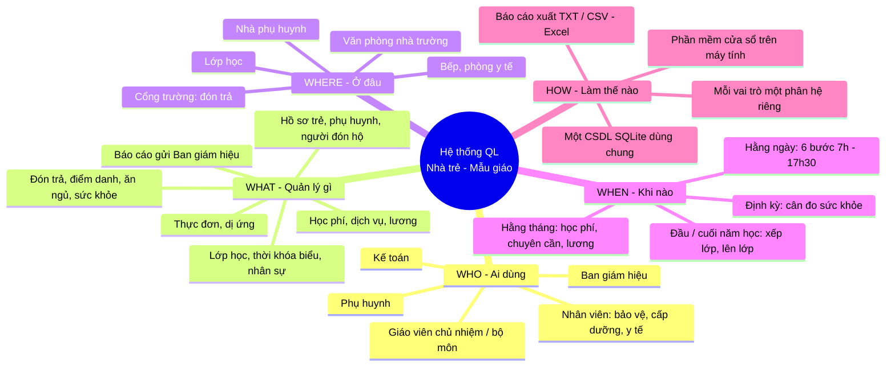

# I. KHẢO SÁT - Hệ thống quản lý Nhà trẻ - Mẫu giáo

Theo *Hướng dẫn xây dựng HTTTQL* (SAMI - HUST), bước Khảo sát trả lời **4W + 1H** và thu thập **output** gồm
biểu mẫu, báo cáo, dữ liệu, quy trình. Output này là **input của bước Phân tích** (`02_PhanTich.md`).

## 1. Đặt câu hỏi 4W + 1H

| Câu hỏi | Trả lời |
|---|---|
| **WHO** - ai sử dụng? | 5 nhóm người dùng, mỗi nhóm một phân hệ: Ban giám hiệu (quản trị toàn trường), Giáo viên (lớp chủ nhiệm), Kế toán (học phí, lương), Nhân viên (bảo vệ đón trả, cấp dưỡng lập thực đơn, y tế cân đo / dị ứng), Phụ huynh (theo dõi con) |
| **WHAT** - hệ thống quản lý gì? | Hồ sơ trẻ - phụ huynh - nhân sự - lớp; vận hành hằng ngày (đón trẻ, điểm danh, ăn ngủ, trao đổi phụ huynh, trả trẻ, báo cáo cuối ngày); sức khỏe - dinh dưỡng; học phí - dịch vụ - lương; báo cáo các bộ phận gửi Ban giám hiệu |
| **WHERE** - dùng ở đâu? | Văn phòng (BGH, kế toán), lớp học (giáo viên), cổng trường (bảo vệ), bếp (cấp dưỡng), phòng y tế, nhà phụ huynh |
| **WHEN** - khi nào? | Hằng ngày theo 6 bước (7h00 đón trẻ → 17h30 báo cáo cuối ngày); hằng tháng (lập hóa đơn ngày 1, chuyên cần, chốt lương); định kỳ (cân đo); đầu / cuối năm học (xếp lớp, kết thúc năm học) |
| **HOW** - thực hiện thế nào? | Chương trình Python - giao diện Tkinter, đăng nhập theo vai trò; dữ liệu lưu trong một file CSDL SQLite; báo cáo gửi BGH duyệt trong chương trình, xuất TXT / CSV |

## 2. Đặt vấn đề - ý nghĩa của hệ thống

Một trường mầm non quy mô vài lớp có hàng chục trẻ, mỗi ngày phát sinh rất nhiều thông tin nhỏ nhưng quan trọng:
trẻ nào đã đến, ai đưa, ai đón; bé ăn ngủ thế nào; phụ huynh dặn uống thuốc; bé dị ứng món gì; ai còn nợ học phí...
Những thông tin này liên quan đến **an toàn của trẻ** (giao nhầm người đón, ăn phải món dị ứng) và **tiền** (thu học
phí, miễn giảm, lương), nên cần được ghi chép đầy đủ, tra cứu nhanh và có người chịu trách nhiệm.

Hệ thống giúp: (1) số hóa toàn bộ hồ sơ và nghiệp vụ hằng ngày; (2) mỗi người chỉ thấy và làm đúng phần việc của mình;
(3) tự tính học phí, tiền ăn theo ngày đi học thực tế, miễn giảm, lương; (4) cảnh báo dị ứng khi lập thực đơn, kiểm tra
người đón trẻ; (5) Ban giám hiệu nắm tình hình toàn trường qua báo cáo các bộ phận gửi lên.

## 3. Hệ thống cũ và các nhược điểm

| Công việc | Cách làm cũ | Nhược điểm |
|---|---|---|
| Hồ sơ trẻ, phụ huynh | Sổ tay + file Excel rời mỗi lớp | Trùng lặp, mỗi người giữ một bản, khó tìm, dễ mất |
| Đón - trả trẻ | Bảo vệ nhớ mặt phụ huynh | Không kiểm tra được người đón hộ, không ghi giờ |
| Điểm danh | Sổ điểm danh giấy | Cuối tháng phải đếm tay để tính tiền ăn, chuyên cần |
| Ăn ngủ, trao đổi phụ huynh | Nhắn Zalo cá nhân | Không lưu tập trung, BGH không theo dõi được, dặn thuốc dễ quên |
| Thực đơn, dị ứng | Cấp dưỡng ghi bảng | Không đối chiếu được món ăn với danh sách trẻ dị ứng |
| Học phí | Excel của kế toán | Tính tay tiền ăn, miễn giảm (con thứ 2, hộ nghèo) dễ sai; phiếu thu viết tay |
| Lương | Excel | Tính hệ số, phụ cấp thủ công, không chốt kỳ |
| Báo cáo | Gửi giấy / Zalo cho BGH | Không có mẫu chung, không biết lớp nào chưa gửi, không lưu hồ sơ |

## 4. Đề xuất hệ thống mới và các yêu cầu

**Yêu cầu chức năng** (chi tiết ở Sơ đồ phân cấp chức năng - `02_PhanTich.md`):
1. Quản trị hệ thống: đăng nhập, phân quyền theo vai trò, tài khoản (tạo / khóa / duyệt đăng ký), đổi mật khẩu,
   sao lưu - khôi phục, nhật ký thao tác.
2. Quản lý danh mục: trẻ, phụ huynh, người đón hộ, nhân sự, lớp học, dịch vụ tự chọn, lịch năm học.
3. Nghiệp vụ chăm sóc - giáo dục: đón trẻ, điểm danh, nhật ký ăn ngủ, trao đổi phụ huynh (lời nhắn, dặn thuốc, xin
   nghỉ), trả trẻ (kiểm tra người đón), sức khỏe - dị ứng, thời khóa biểu, thực đơn có cảnh báo dị ứng.
4. Nghiệp vụ tài chính: lập hóa đơn tháng tự động, thu tiền - phiếu thu, công nợ, dịch vụ, bảng lương.
5. Báo cáo thống kê: tổng quan, 11 loại báo cáo, gửi - duyệt - yêu cầu bổ sung, báo cáo toàn trường.

**Yêu cầu phi chức năng:** giao diện tiếng Việt dễ dùng cho người không chuyên; dữ liệu không mất khi đóng chương trình
(lưu sau mỗi thao tác, giao dịch toàn vẹn); mật khẩu được băm; mỗi vai trò chỉ thấy dữ liệu của mình (giáo viên chỉ
thấy lớp mình, phụ huynh chỉ thấy con mình); chạy được trên máy tính Windows thông thường, không cần cài máy chủ.

## 5. Phạm vi của hệ thống mới

- **Trong phạm vi:** một trường mầm non (nhiều lớp, nhiều khối Nhà trẻ / Mầm / Chồi / Lá), toàn bộ nghiệp vụ ở mục 4,
  dữ liệu trên một file CSDL.
- **Ngoài phạm vi:** thanh toán trực tuyến, ứng dụng điện thoại cho phụ huynh, camera, nhiều cơ sở / chuỗi trường,
  kết nối phần mềm của Sở / Phòng giáo dục.

## 6. Output thu thập được (input của bước Phân tích)

### A. Biểu mẫu (chứng từ nhập liệu)
| Biểu mẫu | Người lập | Form trong chương trình |
|---|---|---|
| Phiếu tiếp nhận trẻ (hồ sơ trẻ + phụ huynh + người đón hộ) | Văn phòng | `frm002_dm_tre`, `frm003_dm_phu_huynh` |
| Sổ đón trẻ / trả trẻ (giờ, người đưa, người đón) | Giáo viên, bảo vệ | `frm009_nv_don_tra_tre` |
| Sổ điểm danh | Giáo viên | `frm010_nv_diem_danh` |
| Phiếu nhật ký ăn - ngủ hằng ngày | Giáo viên | `frm011_nv_an_ngu_sinh_hoat` |
| Phiếu dặn thuốc / đơn xin nghỉ của phụ huynh | Phụ huynh | `frm018_nv_trao_doi_voi_co`, `frm012_nv_trao_doi_phu_huynh` |
| Phiếu cân đo, thông tin dị ứng | Y tế | `frm013_nv_suc_khoe` |
| Thực đơn ngày | Cấp dưỡng | `frm015_nv_thuc_don` |
| Phiếu thu học phí | Kế toán | `frm021_nv_hoc_phi` |

### B. Báo cáo (11 loại - xem `03_ThietKe_BieuMau.md`)
Báo cáo cuối ngày của lớp, đón - trả trẻ trong ngày, chuyên cần tháng, y tế - sức khỏe, bếp - thực đơn tuần, doanh thu
tháng, công nợ, bảng lương tháng, sĩ số toàn trường, tổng hợp ngày / tháng toàn trường.

### C. Dữ liệu
Trẻ, phụ huynh, người đón hộ, nhân sự (giáo viên, nhân viên), lớp, khối, thời khóa biểu, điểm danh - đón trả, đơn xin
nghỉ, nhật ký ăn ngủ, tin nhắn, cân đo, dị ứng, món ăn - thành phần, thực đơn, dịch vụ, hóa đơn - khoản phí - phiếu thu,
bảng lương, báo cáo, tài khoản, tham số (học phí, tiền ăn, tỷ lệ miễn giảm, lương cơ sở), ngày nghỉ lễ.
→ thiết kế thành 42 bảng: `Database/thiet_ke_csdl.md`.

### D. Quy trình
1. **Một ngày ở trường (6 bước):** ① Đón trẻ 7h00-8h00 → ② Điểm danh 8h00-8h30 → ③ Cập nhật ăn ngủ 10h30-14h00 →
   ④ Tương tác phụ huynh 14h00-15h00 → ⑤ Trả trẻ 16h00-17h00 (kiểm tra người đón) → ⑥ Báo cáo cuối ngày gửi BGH.
2. **Học phí hằng tháng:** ngày 1 lập hóa đơn tháng trước (học phí theo khối + tiền ăn = số ngày có mặt × đơn giá +
   dịch vụ − miễn giảm) → gửi phụ huynh → thu tiền, in phiếu thu → theo dõi công nợ, quá hạn.
3. **Báo cáo:** bộ phận lập báo cáo (số liệu tự tổng hợp) + ghi chú → gửi BGH → BGH duyệt hoặc yêu cầu bổ sung →
   bộ phận cập nhật, gửi lại → BGH tổng hợp báo cáo toàn trường từ các báo cáo đã gửi.
4. **Tiếp nhận trẻ:** nhập hồ sơ → liên kết phụ huynh, người đón hộ → xếp lớp đúng độ tuổi → đăng ký dịch vụ.
