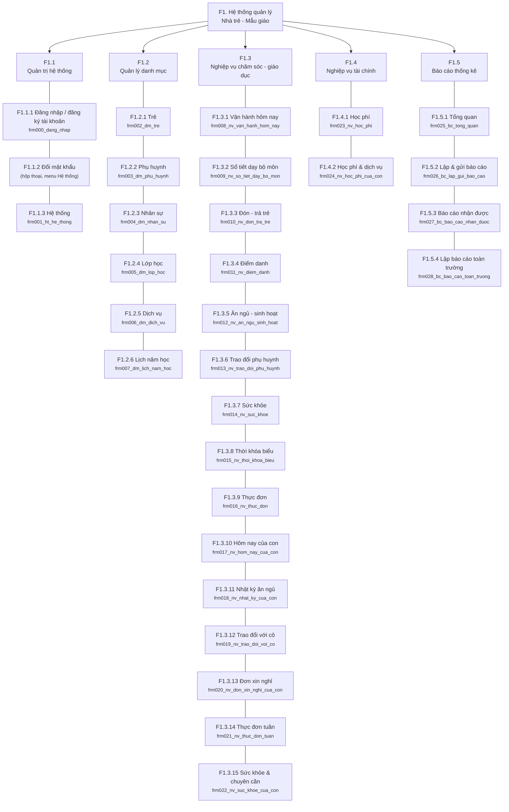
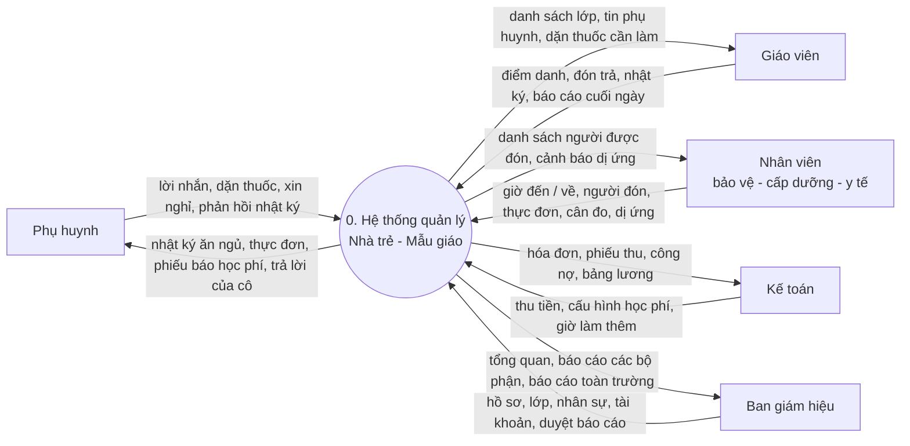
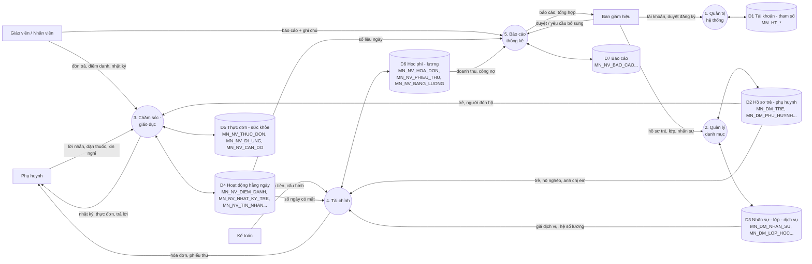

# II. PHÂN TÍCH - Hệ thống quản lý Nhà trẻ - Mẫu giáo

Input: output của Khảo sát (`01_KhaoSat.md`). Output của bước Phân tích theo hướng dẫn:

| Góc nhìn | Sơ đồ | Ở đâu |
|---|---|---|
| Chức năng | **Sơ đồ phân cấp chức năng** (BFD) | Mục 1 (tự sinh từ menu chương trình) |
| Chức năng - Dữ liệu | **Sơ đồ luồng dữ liệu** (DFD) | Mục 2 |
| Dữ liệu | **Sơ đồ thực thể liên kết** (ERD) | `Database/thiet_ke_csdl.md` (mục 2 - 4) |

## 1. Sơ đồ phân cấp chức năng

Theo yêu cầu của hướng dẫn: **5 chức năng đỉnh, 3 cấp**; 3 chức năng chung (F1.1 Quản trị hệ thống, F1.2 Quản lý
thông tin danh mục, F1.5 Báo cáo thống kê) + 2 chức năng nghiệp vụ riêng (F1.3, F1.4). Đây là **chức năng chương
trình**: mỗi chức năng lá ứng với **một form** (mã form theo quy ước `frm` + số + loại + tên).

> Phần dưới được sinh tự động từ menu thật của chương trình (`NAVIGATION`, `FORM_CODES` trong
> `kindergarten/ui/gui/app.py`) bằng `python Resource/TaiLieu/sinh_tai_lieu.py` - đổi menu thì chạy lại để cập nhật.

<!-- BFD:BEGIN -->

**5 chức năng đỉnh, 30 chức năng lá (form)** - 3 cấp: F1 → F1.x → F1.x.y.

| Mã chức năng | Chức năng | Form | Vai trò được dùng |
|---|---|---|---|
| **F1.1** | **Quản trị hệ thống** | | |
| F1.1.1 | Đăng nhập / đăng ký tài khoản | `frm000_dang_nhap` | mọi người dùng |
| F1.1.2 | Đổi mật khẩu | `(hộp thoại, menu Hệ thống)` | mọi vai trò |
| F1.1.3 | Hệ thống | `frm001_ht_he_thong` | Ban giám hiệu (Quản trị) |
| **F1.2** | **Quản lý danh mục** | | |
| F1.2.1 | Trẻ | `frm002_dm_tre` | Ban giám hiệu (Quản trị), Giáo viên |
| F1.2.2 | Phụ huynh | `frm003_dm_phu_huynh` | Ban giám hiệu (Quản trị), Giáo viên |
| F1.2.3 | Nhân sự | `frm004_dm_nhan_su` | Ban giám hiệu (Quản trị), Kế toán |
| F1.2.4 | Lớp học | `frm005_dm_lop_hoc` | Ban giám hiệu (Quản trị) |
| F1.2.5 | Dịch vụ | `frm006_dm_dich_vu` | Ban giám hiệu (Quản trị), Kế toán |
| F1.2.6 | Lịch năm học | `frm007_dm_lich_nam_hoc` | Ban giám hiệu (Quản trị) |
| **F1.3** | **Nghiệp vụ chăm sóc - giáo dục** | | |
| F1.3.1 | Vận hành hôm nay | `frm008_nv_van_hanh_hom_nay` | Ban giám hiệu (Quản trị) |
| F1.3.2 | Sổ tiết dạy bộ môn | `frm009_nv_so_tiet_day_bo_mon` | Ban giám hiệu (Quản trị) |
| F1.3.3 | Đón - trả trẻ | `frm010_nv_don_tra_tre` | Ban giám hiệu (Quản trị), NV bảo vệ - đón trả trẻ ở cổng |
| F1.3.4 | Điểm danh | `frm011_nv_diem_danh` | Ban giám hiệu (Quản trị) |
| F1.3.5 | Ăn ngủ - sinh hoạt | `frm012_nv_an_ngu_sinh_hoat` | Ban giám hiệu (Quản trị) |
| F1.3.6 | Trao đổi phụ huynh | `frm013_nv_trao_doi_phu_huynh` | Ban giám hiệu (Quản trị) |
| F1.3.7 | Sức khỏe | `frm014_nv_suc_khoe` | Ban giám hiệu (Quản trị), NV y tế - sức khỏe trẻ |
| F1.3.8 | Thời khóa biểu | `frm015_nv_thoi_khoa_bieu` | Ban giám hiệu (Quản trị), Giáo viên |
| F1.3.9 | Thực đơn | `frm016_nv_thuc_don` | Ban giám hiệu (Quản trị), NV bếp - cấp dưỡng |
| F1.3.10 | Hôm nay của con | `frm017_nv_hom_nay_cua_con` | Phụ huynh |
| F1.3.11 | Nhật ký ăn ngủ | `frm018_nv_nhat_ky_cua_con` | Phụ huynh |
| F1.3.12 | Trao đổi với cô | `frm019_nv_trao_doi_voi_co` | Phụ huynh |
| F1.3.13 | Đơn xin nghỉ | `frm020_nv_don_xin_nghi_cua_con` | Phụ huynh |
| F1.3.14 | Thực đơn tuần | `frm021_nv_thuc_don_tuan` | Phụ huynh |
| F1.3.15 | Sức khỏe & chuyên cần | `frm022_nv_suc_khoe_cua_con` | Phụ huynh |
| **F1.4** | **Nghiệp vụ tài chính** | | |
| F1.4.1 | Học phí | `frm023_nv_hoc_phi` | Ban giám hiệu (Quản trị), Kế toán |
| F1.4.2 | Học phí & dịch vụ | `frm024_nv_hoc_phi_cua_con` | Phụ huynh |
| **F1.5** | **Báo cáo thống kê** | | |
| F1.5.1 | Tổng quan | `frm025_bc_tong_quan` | Ban giám hiệu (Quản trị) |
| F1.5.2 | Lập & gửi báo cáo | `frm026_bc_lap_gui_bao_cao` | Giáo viên, Kế toán, NV bếp - cấp dưỡng, NV bảo vệ - đón trả trẻ ở cổng, NV y tế - sức khỏe trẻ, NV nhân viên |
| F1.5.3 | Báo cáo nhận được | `frm027_bc_bao_cao_nhan_duoc` | Ban giám hiệu (Quản trị) |
| F1.5.4 | Lập báo cáo toàn trường | `frm028_bc_bao_cao_toan_truong` | Ban giám hiệu (Quản trị) |
<!-- BFD:END -->

## 2. Sơ đồ luồng dữ liệu

Các thành phần (theo bảng ký hiệu của hướng dẫn):

| Khái niệm | Biểu diễn trong sơ đồ dưới | Ý nghĩa |
|---|---|---|
| Xử lý | hình tròn / bo tròn `(( ))` | một hoạt động bên trong hệ thống |
| Dòng dữ liệu | mũi tên có nhãn | thông tin chuyển giữa các xử lý |
| Kho dữ liệu | hình trụ `[( )]`, tên D1, D2... | vùng chứa thông tin (nhóm bảng trong CSDL) |
| Tác nhân ngoài (đầu cuối) | hình chữ nhật | người / bộ phận bên ngoài hệ thống |

### 2.1. Mức ngữ cảnh (mức 0)

### 2.2. Mức đỉnh (mức 1) - phân rã theo 5 chức năng đỉnh

### 2.3. Phân tích xử lý

| Xử lý | Dữ liệu vào | Xử lý chính | Dữ liệu ra |
|---|---|---|---|
| 1. Quản trị hệ thống | tên đăng nhập, mật khẩu; yêu cầu đăng ký | kiểm tra mật khẩu băm, khóa sau nhiều lần sai, phân quyền theo vai trò, duyệt đăng ký, sao lưu / khôi phục, ghi nhật ký | phiên đăng nhập + đúng phân hệ; D1 |
| 2. Quản lý danh mục | hồ sơ trẻ / phụ huynh / nhân sự / lớp | kiểm tra hợp lệ (tuổi, SĐT, sĩ số tối đa, trùng), liên kết trẻ - phụ huynh, xếp lớp đúng độ tuổi, thôi học / lên lớp | D2, D3 |
| 3. Chăm sóc - giáo dục | giờ đến / về, người đưa / đón, điểm danh, ăn ngủ, tin nhắn, thực đơn, cân đo | đón trẻ = có mặt; kiểm tra người đón có trong danh sách; đơn xin nghỉ → vắng có phép; cảnh báo món có chất dị ứng; tính BMI, đánh giá dinh dưỡng | D4, D5; nhật ký gửi phụ huynh |
| 4. Tài chính | tháng, tham số học phí, số ngày có mặt, dịch vụ, tiền nộp | học phí theo khối + tiền ăn (ngày có mặt × đơn giá) + dịch vụ − miễn giảm (con thứ 2, hộ nghèo); phiếu thu, hủy phiếu; lương = hệ số × lương cơ sở + phụ cấp | D6; phiếu báo học phí, phiếu thu, bảng lương |
| 5. Báo cáo thống kê | kỳ (ngày / tháng), phạm vi lớp, ghi chú | tổng hợp số liệu từ D2 - D6, chốt số liệu khi gửi, BGH duyệt / yêu cầu bổ sung, tổng hợp báo cáo toàn trường | D7; báo cáo xem / xuất TXT, CSV |

## 3. Sơ đồ thực thể liên kết

Đã thực hiện cùng phần Thiết kế CSDL: `Database/thiet_ke_csdl.md`
- mục 2 - thực thể cụ thể / trừu tượng / phụ,
- mục 3 - quan hệ 1-1, 1-n, n-n và thuộc tính của liên kết n-n,
- mục 4 - sơ đồ ERD (Mermaid), mục 5 - 6 - mô hình quan hệ, khóa chính / ngoại, từ điển dữ liệu.
