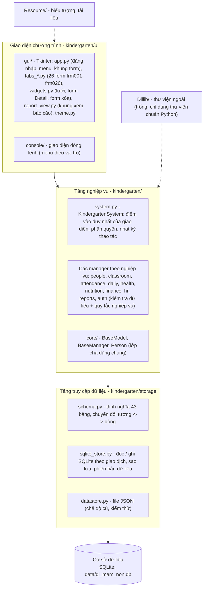

# IV. CÀI ĐẶT - Xây dựng chương trình

## 1. Kiến trúc hệ thống

Chương trình chia **3 tầng** nằm giữa "Giao diện chương trình" và "Cơ sở dữ liệu" (sơ đồ Kiến trúc hệ thống của
hướng dẫn); tầng trên chỉ gọi tầng ngay dưới nó.

| Tầng | Trách nhiệm | Không được làm |
|---|---|---|
| Giao diện | hiển thị, nhận thao tác, gọi `system` / manager, hiện Message Box kết quả | truy cập CSDL trực tiếp, tự tính tiền / kiểm tra nghiệp vụ |
| Nghiệp vụ | kiểm tra dữ liệu, quy tắc (tuổi xếp lớp, miễn giảm, người đón...), phân quyền, giữ dữ liệu trong bộ nhớ | biết CSDL là SQLite hay JSON |
| Truy cập dữ liệu | đổi đối tượng ↔ dòng bảng, ghi trong một giao dịch, chỉ ghi phần thay đổi | chứa quy tắc nghiệp vụ |
| CSDL | lưu trữ, khóa chính / ngoại, CHECK, cột tính toán | - |

## 2. Solution Convention

| Mục (hướng dẫn) | Ví dụ của hướng dẫn | Áp dụng trong dự án |
|---|---|---|
| Solution Name | `QuanLyDiemv2012.05.02` | **`QuanLyNhaTreMauGiaov2026.11.17.sln`** (tên + phiên bản theo ngày) |
| Solution Folder | `Database`, `Dlllib`, `Resource` | **`Database/`** - script tạo CSDL, truy vấn mẫu, thiết kế CSDL; **`Dlllib/`** - thư viện ngoài (trống, xem README); **`Resource/`** - `Icons/` biểu tượng chương trình, `TaiLieu/` tài liệu khảo sát - phân tích - thiết kế - kiểm thử |
| Project | | `HTTTQL_NhaTreMauGiao.pyproj` (Python, khởi động `main.py --gui`) |
| Form | `frm000_dang_nhap`, `frm001_dm_sinh_vien`, `frm002_nv_sinh_vien` | `frm000_dang_nhap` ... `frm026_bc_bao_cao_toan_truong` - bảng ở mục 3.1 |

Khi phát hành phiên bản mới: đổi ngày trong tên solution (VD `QuanLyNhaTreMauGiaov2026.12.01.sln`).

## 3. Naming Convention

Nguyên tắc chung của hướng dẫn: **đủ dài - dễ hiểu - tránh nhầm lẫn**, dùng tiếng Anh hoặc tiếng Việt đều được.

| Đối tượng | Quy ước của hướng dẫn | Áp dụng trong dự án |
|---|---|---|
| **Form** | `f` + số + `_` + tên, VD `frm000_dang_nhap` | `frm` + 3 chữ số + `_` + loại (`ht` hệ thống / `dm` danh mục / `nv` nghiệp vụ / `bc` báo cáo) + `_` + tên. Hiện trên thanh tiêu đề cửa sổ và dòng đường dẫn của mỗi form |
| **Control** | KHÔNG VIẾT HOA: `m` + `_` + loại + `_` + tên; loại: `txt` TextBox, `cbo` ComboBox, `fg` lưới, `chk` CheckBox, `lbl` Label, `e` enum, `dr` datarow. VD `m_txt_contract_name`, `m_cbo_country` | **Đã áp dụng cho control trên các form** (`kindergarten/ui/gui/app.py`, `tabs_*.py`): `m_txt_` ô nhập / ô văn bản, `m_cbo_` combobox, `m_fg_` lưới dữ liệu, `m_lbl_` nhãn; bổ sung `m_btn_` nút bấm, `m_tab_` thẻ (hai loại control có trong danh sách control của hướng dẫn nhưng chưa có tiền tố). VD `self.m_fg_list`, `self.m_cbo_class`, `self.m_txt_note`, `self.m_lbl_count`, `self.m_btn_save` |
| **Biến** | KHÔNG VIẾT HOA: vùng (`v` biến cục bộ / `m` thành viên / `i` vào / `o` ra) + `_` + kiểu (`dc`, `i`, `b`, `str`, `dat`...) + `_` + tên | Tầng nghiệp vụ và truy cập dữ liệu **giữ chuẩn PEP 8 của Python** (`snake_case`, có chú thích kiểu `-> int`, `: str`). Lý do: Python đã ghi kiểu bằng *type hint* nên tiền tố kiểu bị trùng lặp; đổi hàng nghìn tên biến dễ phát sinh lỗi mà không thêm thông tin |
| **TABLE** | VIẾT HOA: `SUB_SYSTEM` + `PURPOSE_TYPE` + `NAME`, VD `T2C_GD_TRANSACTION` | `MN_` + `HT` / `DM` / `NV` + `_` + tên, VD `MN_DM_TRE`, `MN_NV_HOA_DON` (43 bảng, `Database/thiet_ke_csdl.md`) |
| **DATASET** | VIẾT HOA: `DS` + `TABLE_NAME` | Không dùng DataSet (khái niệm của .NET). Tương đương: dữ liệu đọc từ bảng `MN_DM_TRE` nạp vào đối tượng quản lý `system.children` (`ChildManager`) |
| **USObject** | VIẾT HOA: `US` + `TABLE_NAME` | Tương đương: lớp đối tượng nghiệp vụ ứng với bảng - `Child` ↔ `MN_DM_TRE`, `Invoice` ↔ `MN_NV_HOA_DON`... (ánh xạ ở `kindergarten/storage/schema.py`, mục ENCODERS) |

### 3.1. Danh sách form (sinh tự động từ `FORM_CODES`)

<!-- FORMS:BEGIN -->
| Mã form | Form | Nhóm chức năng | Loại |
|---|---|---|---|
| `frm000_dang_nhap` | Đăng nhập | F1.1 Quản trị hệ thống | ht - hệ thống |
| `frm001_ht_he_thong` | Hệ thống | F1.1 Quản trị hệ thống | ht - hệ thống |
| `frm002_dm_tre` | Trẻ | F1.2 Quản lý danh mục | dm - danh mục (Master - Detail) |
| `frm003_dm_phu_huynh` | Phụ huynh | F1.2 Quản lý danh mục | dm - danh mục (Master - Detail) |
| `frm004_dm_nhan_su` | Nhân sự | F1.2 Quản lý danh mục | dm - danh mục (Master - Detail) |
| `frm005_dm_lop_hoc` | Lớp học | F1.2 Quản lý danh mục | dm - danh mục (Master - Detail) |
| `frm006_dm_dich_vu` | Dịch vụ | F1.2 Quản lý danh mục | dm - danh mục (Master - Detail) |
| `frm007_dm_lich_nam_hoc` | Lịch năm học | F1.2 Quản lý danh mục | dm - danh mục (Master - Detail) |
| `frm008_nv_van_hanh_hom_nay` | Vận hành hôm nay | F1.3 Chăm sóc - vận hành | nv - nghiệp vụ |
| `frm010_nv_don_tra_tre` | Đón - trả trẻ | F1.3 Chăm sóc - vận hành | nv - nghiệp vụ |
| `frm011_nv_diem_danh` | Điểm danh | F1.3 Chăm sóc - vận hành | nv - nghiệp vụ |
| `frm012_nv_an_ngu_sinh_hoat` | Ăn ngủ - sinh hoạt | F1.3 Chăm sóc - vận hành | nv - nghiệp vụ |
| `frm013_nv_trao_doi_phu_huynh` | Trao đổi phụ huynh | F1.3 Chăm sóc - vận hành | nv - nghiệp vụ |
| `frm014_nv_suc_khoe` | Sức khỏe | F1.3 Chăm sóc - vận hành | nv - nghiệp vụ |
| `frm016_nv_thuc_don` | Thực đơn | F1.3 Chăm sóc - vận hành | nv - nghiệp vụ |
| `frm017_nv_hom_nay_cua_con` | Hôm nay của con | F1.3 Chăm sóc - vận hành | nv - nghiệp vụ |
| `frm018_nv_nhat_ky_cua_con` | Nhật ký ăn ngủ | F1.3 Chăm sóc - vận hành | nv - nghiệp vụ |
| `frm019_nv_trao_doi_voi_co` | Trao đổi với cô | F1.3 Chăm sóc - vận hành | nv - nghiệp vụ |
| `frm020_nv_thuc_don_tuan` | Thực đơn tuần | F1.3 Chăm sóc - vận hành | nv - nghiệp vụ |
| `frm021_nv_suc_khoe_cua_con` | Sức khỏe & chuyên cần | F1.3 Chăm sóc - vận hành | nv - nghiệp vụ |
| `frm022_nv_hoc_phi` | Học phí | F1.4 Nghiệp vụ tài chính | nv - nghiệp vụ |
| `frm023_nv_hoc_phi_cua_con` | Học phí & dịch vụ | F1.4 Nghiệp vụ tài chính | nv - nghiệp vụ |
| `frm024_bc_tong_quan` | Tổng quan | F1.5 Báo cáo thống kê | bc - báo cáo |
| `frm025_bc_lap_gui_bao_cao` | Lập & gửi báo cáo | F1.5 Báo cáo thống kê | bc - báo cáo |
| `frm026_bc_bao_cao_nhan_duoc` | Báo cáo nhận được | F1.5 Báo cáo thống kê | bc - báo cáo |
| `frm027_bc_bao_cao_toan_truong` | Lập báo cáo toàn trường | F1.5 Báo cáo thống kê | bc - báo cáo |
| `frm009_nv_so_tiet_day_bo_mon` | Sổ tiết dạy bộ môn | F1.6 Giáo dục - chuyên môn | nv - nghiệp vụ |
| `frm015_nv_thoi_khoa_bieu` | Thời khóa biểu | F1.6 Giáo dục - chuyên môn | nv - nghiệp vụ |
<!-- FORMS:END -->

## 4. Coding Convention

| Mục | Quy ước |
|---|---|
| **Style** | PEP 8, dòng ≤ 120 ký tự, thụt lề 4 dấu cách; docstring và chú thích tiếng Việt; mọi hàm có chú thích kiểu; thông báo cho người dùng bằng tiếng Việt có dấu |
| **Naming** | như mục 3 |
| **Solutions** (cách giải quyết dùng chung) | Mọi đối tượng kế thừa `BaseModel` (sinh mã `C001`, `HD012`...; `to_dict` / `from_dict`); mọi danh sách kế thừa `BaseManager` (thêm / sửa / xóa / tìm + kiểm tra quyền); lỗi nghiệp vụ là `KindergartenError` để giao diện hiện Message Box; giao diện gọi nghiệp vụ qua `BaseTab.guard()` (lỗi → báo, thành công → lưu + làm mới + báo kết quả); form Detail qua `BaseTab.form()`, form xóa qua `BaseTab.confirm_delete()` |
