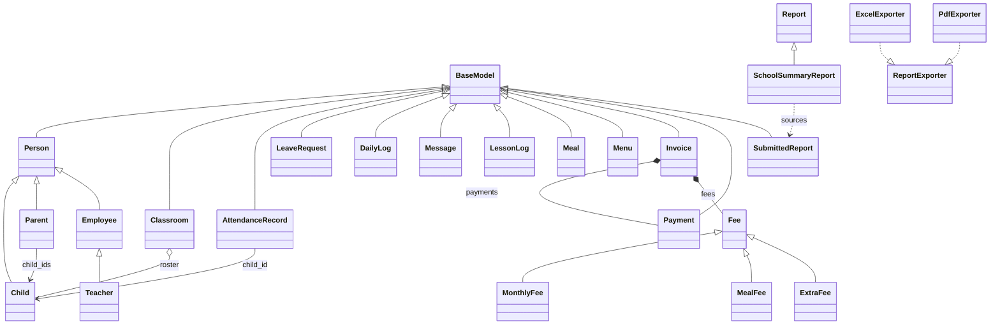
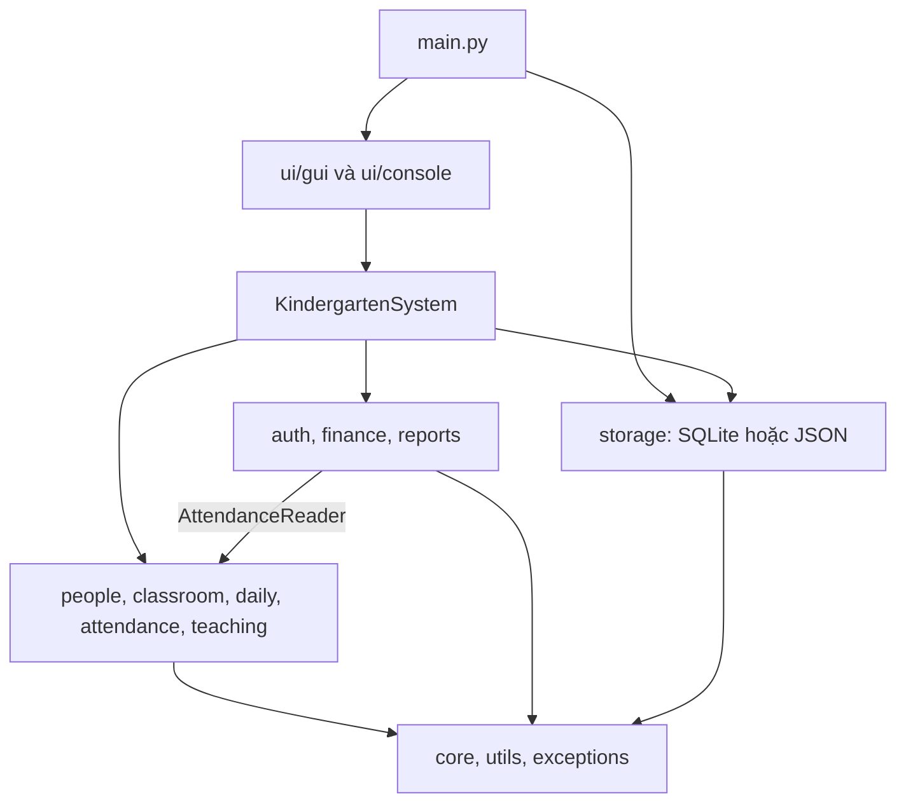
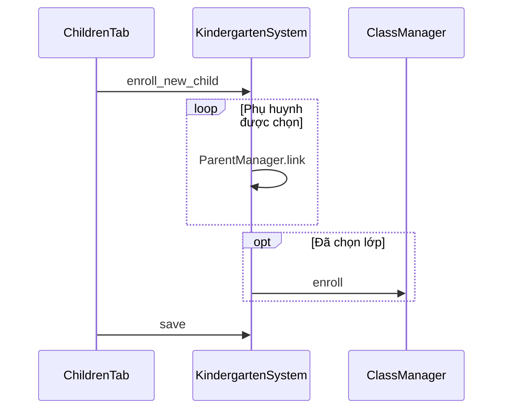
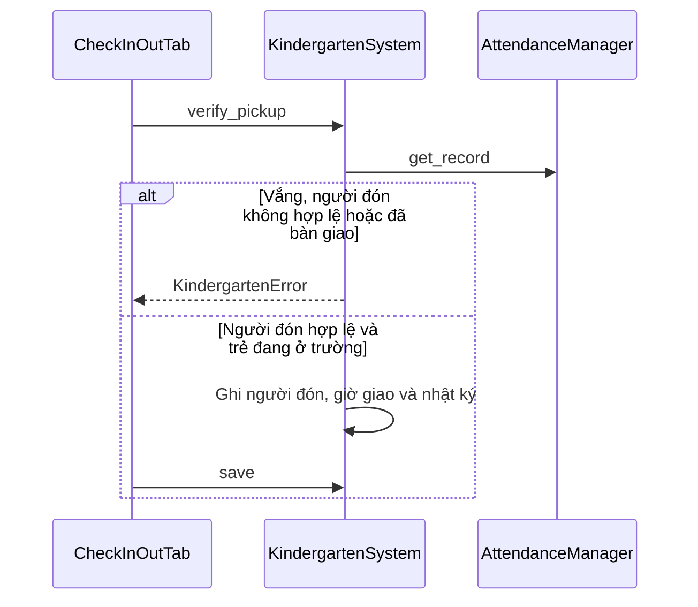
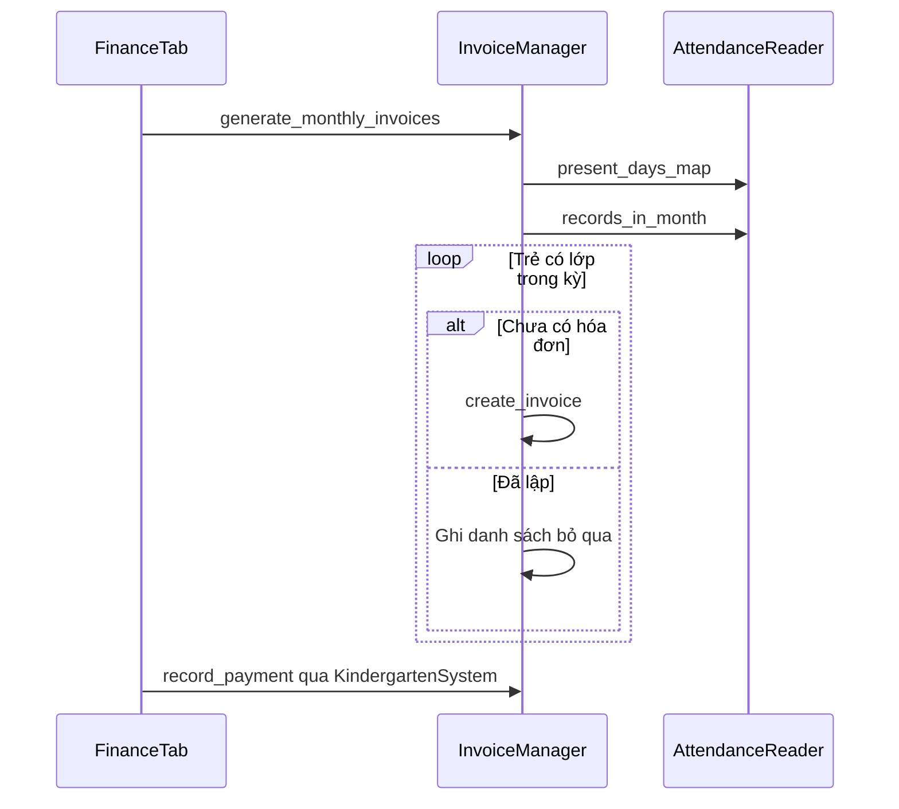
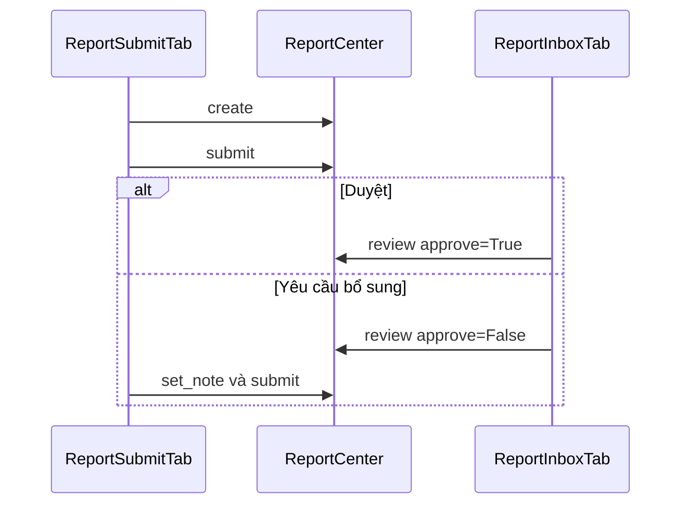

# Truy vết nghiệp vụ nhóm hai người

Phương án phân công để nhóm xác nhận theo công việc thực tế. TV1 phụ trách F1.2, F1.3 và F1.6.
TV2 phụ trách F1.1, F1.4 và F1.5. Hai luồng tích hợp là điểm danh → học phí và báo cáo lớp → báo cáo toàn trường.

| UC | Phụ trách | Form | Hàm hoặc lớp nghiệp vụ | Minh chứng kiểm thử |
|---|---|---|---|---|
| Tiếp nhận và xếp lớp | TV1 | frm002, frm005 | `enroll_new_child`, `ClassManager.enroll` | `test_classroom.py`, `test_review_fixes.py` |
| Đón và bàn giao trẻ | TV1 | frm010 | `DailyManager.check_in`, `verify_pickup` | `test_pickup_verification` |
| Điểm danh theo lớp | TV1 | frm011 | `take_class_attendance`, `present_days_map` | `test_attendance.py`, `test_generate_monthly_invoices` |
| Ghi sổ tiết dạy | TV1 | frm009 | `LessonLogManager.save_lesson` | `test_teaching.py` |
| Duyệt tài khoản | TV2 | frm001 | `approve_user`, `AuthManager` | `test_auth.py`, `test_portals_daily.py` |
| Lập hóa đơn theo kỳ | TV2 | frm022 | `InvoiceManager.generate_monthly_invoices` | `test_generate_monthly_invoices` |
| Thu tiền và hủy phiếu thu | TV2 | frm022 | `record_payment`, `void_payment` | `test_invoice_payment_flow`, `test_l16_void_payment_keeps_trace` |
| Gửi, duyệt và tổng hợp báo cáo | TV2 | frm025–frm027 | `ReportCenter.submit`, `review`, `SchoolSummaryReport` | `test_subsystems_reports.py` |

Bốn giao dịch để đối chiếu đa bảng gồm tiếp nhận trẻ, lưu điểm danh lớp, lập hóa đơn có chi tiết và tổng hợp báo cáo có nguồn.
Hai khóa ngoại tại ranh giới dữ liệu là `MN_NV_HOA_DON.MA_TRE → MN_DM_TRE.MA_TRE` và
`MN_HT_TAI_KHOAN.MA_PHU_HUYNH → MN_DM_PHU_HUYNH.MA_PHU_HUYNH`. Ba bảng liên kết có ngữ cảnh riêng
là trẻ–phụ huynh (thứ tự), trẻ–người đón hộ (thứ tự, quan hệ) và thực đơn–món ăn (bữa, thứ tự).

## Sơ đồ lớp tổng

Các cạnh lần lượt thể hiện tổng quát hóa, kết tập danh sách trẻ, liên kết định danh, sở hữu chi tiết hóa đơn,
phụ thuộc lúc tổng hợp, và hiện thực hợp đồng xuất. Trẻ có vòng đời riêng với lớp. Khoản phí và phiếu thu thuộc
hóa đơn. Ràng buộc nghiệp vụ chặn xóa hóa đơn từng có phiếu thu.

## Gói và chiều phụ thuộc

## Luồng động

